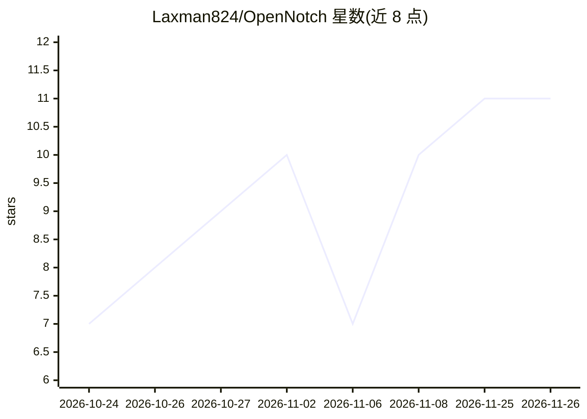

# Laxman824/OpenNotch

⭐ 11 · JavaScript · MIT · 推送 2026-11-22 · [GitHub](https://github.com/Laxman824/OpenNotch) · [官网](https://laxman824.github.io/opennotch/) · 个人维护

**驻留 MacBook 刘海的本地优先 AI 助手，附桌面伴侣**

以 SwiftUI 编写的 macOS 应用，将 AI 助手嵌入 MacBook 刘海区域：Agent 可调用日历、提醒、邮件草稿、文件编辑、shell、网页搜索等工具，操作前经黄色提示与用户确认，语音识别在本机运行。数据存本地，无账号与遥测；AI 后端可选 OpenRouter 登录、API key、Ollama/LM Studio 或 Apple 端侧模型。提供 14 个非 AI 模块（剪贴板、计时器、音乐等）与 Puff/Ledge 等 3D 桌面伴侣。提供 DMG 安装包与源码构建路径。

## 筛选速览

| 维度 | 判定 | 备注 |
|---|---|---|
| AI 角色 | `ai-native` | 本体是模型或模型工具 |
| 许可风险 | `permissive` | MIT |
| 部署形态 | `desktop` | 安装包/桌面程序 |
| 模型依赖 | local-ok | 支持本地模型 |
| 硬件要求 | — | 无带数字的原话,不猜 |
| 安装摩擦 | `low` | 无编译、无系统依赖或容器化 |
| 成熟度 | `idea` | |

## 能力要点

- Agent 调用工具前需确认，邮件仅在批准后发送
- AI 后端可选 OpenRouter/OpenAI/Anthropic/Gemini/Groq API 或 Ollama/LM Studio 本地运行
- 支持 MCP 连接器（Notion、Linear、Zapier 等）与自定义 mcp.json
- 提供 DMG 安装包、源码构建脚本与 CLI

## 适用场景

- 用自然语言管理日程、邮件草稿与文件操作
- 在任何应用中按快捷键解释、总结或起草回复
- 通过 Ollama/LM Studio 实现完全本地化的助手
- 会议本机转录并生成摘要与行动项

## 场景标签

`AI 助手` · 领域:对话与助手

## 证据(README 行号)

> L5: An open-source AI assistant that lives in the notch — it does real work, asks before anything risky,
> L103: |**Ollama / LM Studio**|Either app running with a model downloaded — fully local and free|
> L156: ## Install

## 星数曲线

2026-10-24 7 → 2026-11-26 11（+4）

---
*卡片 v1 · prompt 1.4 · 生成 2026-11-20 · 置信度 high · 依据 README sha `332d6b8b7999` · [字段定义](../../DATASET.md)*
