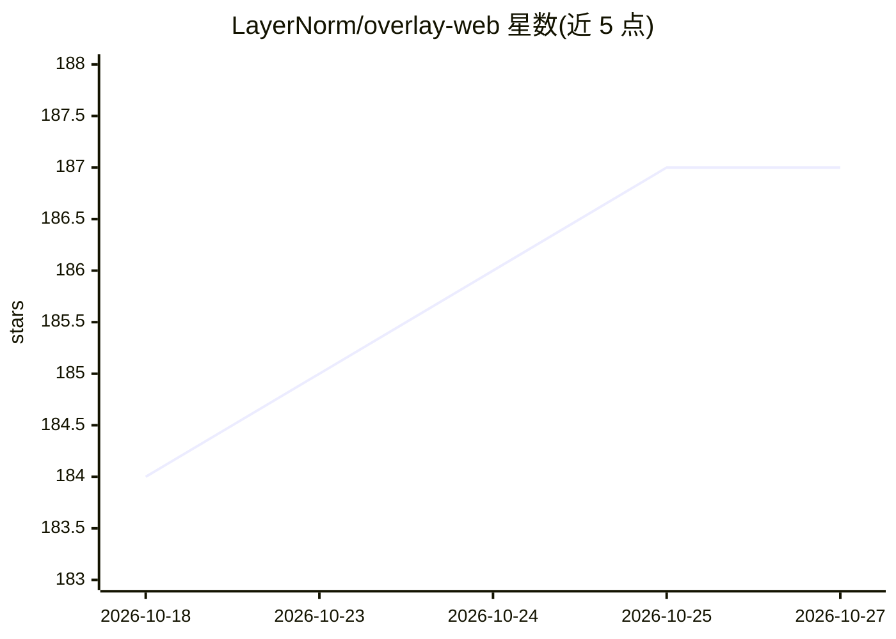

# LayerNorm/overlay-web

⭐ 187 · TypeScript · AGPL-3.0 · 推送 2026-10-26 · [GitHub](https://github.com/LayerNorm/overlay-web) · [官网](https://getoverlay.io/) · 组织维护

**人与 AI agent 共享上下位的开源协作工作区**

开源 Web 工作区应用，供人与一个或多个 AI agent 在同一上下位中协作：上传文件、保存记忆与笔记、按项目组织工作，通过 Chat 模式对话、Work 模式让 agent 调用工具、浏览器或定时自动化执行任务，并检视产出。支持图像/视频生成、语音转录、Composio 100+ 外部应用集成与 MCP 服务器。模型供应商经统一 gateway 适配，保持 provider-neutral。技术栈为 Next.js 15 + Convex + Vercel AI SDK，本地运行需 Node.js 22+ 及 Convex/WorkOS/Stripe 账号，处于活跃开发期。

## 筛选速览

| 维度 | 判定 | 备注 |
|---|---|---|
| AI 角色 | `ai-native` | 本体是模型或模型工具 |
| 许可风险 | `dual` | AGPL-3.0 |
| 部署形态 | `library` | 以包/库形式分发 |
| 模型依赖 | — | README 未给出锁定关系 |
| 硬件要求 | — | 无带数字的原话,不猜 |
| 安装摩擦 | `low` | 无编译、无系统依赖或容器化 |
| 成熟度 | `idea` | |

## 能力要点

- Chat/Work 双模式：对话与 agent 工具执行共享同一上下位
- 图像/视频生成、语音转录、浏览器自动化、定时自动化工作流
- Composio 接入 Gmail/Notion/GitHub 等 100+ 应用，支持 MCP 服务器
- 供应商适配统一在 gateway 之后，README 明示不重复模型目录

## 适用场景

- 在统一工作区中把重复任务委派给 AI agent 并检视结果
- 个人/团队知识库、笔记、文件与对话的集中管理
- 通过定时自动化与外部应用集成执行周期性工作流

## 场景标签

`浏览器自动化` `工作流自动化` `视频生成` `知识库管理` · 领域:效率与自动化

## 证据(README 行号)

> L5: Overlay is an open-source workspace where humans and AI agents share context and get work done together. Keep knowle
> L11: Most AI products stop at a single answer. Overlay is built around the next step: a person and one or more agents wo

## 星数曲线

2026-10-18 184 → 2026-10-27 187（+3）

---
*卡片 v1 · prompt 1.4 · 生成 2026-10-22 · 置信度 high · 依据 README sha `5a63dd7c6e75` · [字段定义](../../DATASET.md)*
