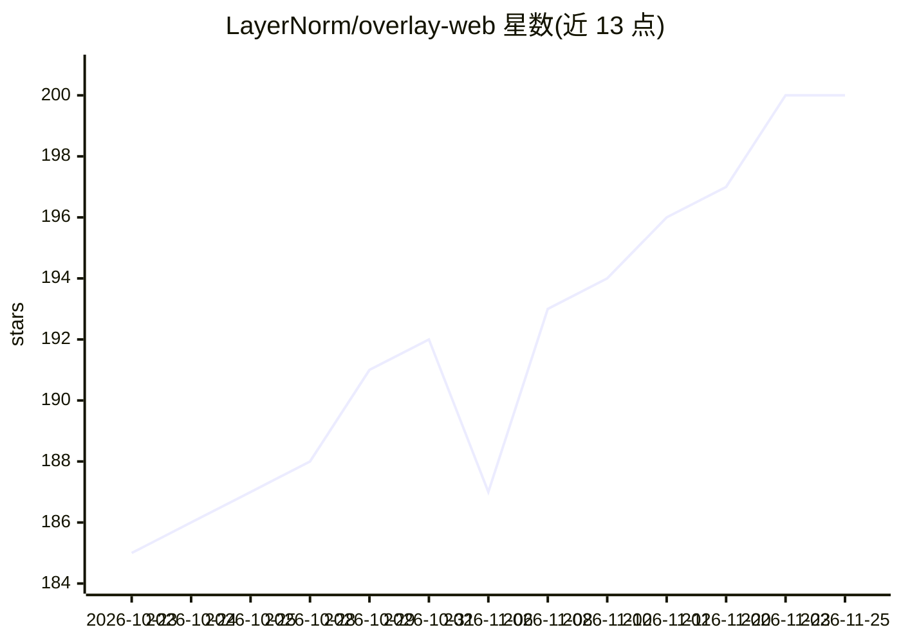

# LayerNorm/overlay-web

⭐ 200 · HTML · AGPL-3.0 · 推送 2026-11-24 · [GitHub](https://github.com/LayerNorm/overlay-web) · [官网](https://getoverlay.io/) · 组织维护

**人与 AI agent 共享上下文协作的开源工作区**

一个开源 Web 工作区，供人类与 AI agent 在同一上下文中协作：提供文件/记忆/笔记/项目组织的知识层，Chat 模式做对话合成，Work 模式让 agent 调用工具、浏览网页并执行任务，用户可审查产出后继续。模型经统一网关接入，保持 provider-neutral；支持定时自动化、MCP 服务器与 100+ 外部应用集成。技术栈为 Next.js 15 + Convex + WorkOS + Stripe，可自托管，需 Node.js 22+ 与 Convex/WorkOS/Stripe 凭据。

## 筛选速览

| 维度 | 判定 | 备注 |
|---|---|---|
| AI 角色 | `ai-native` | 本体是模型或模型工具 |
| 许可风险 | `dual` | AGPL-3.0 |
| 部署形态 | `library` | 以包/库形式分发 |
| 模型依赖 | — | README 未给出锁定关系 |
| 硬件要求 | — | 无带数字的原话,不猜 |
| 安装摩擦 | `low` | 无编译、无系统依赖或容器化 |
| 成熟度 | `idea` | |

## 能力要点

- Chat 与 Work 双模式：对话与 agent 工具执行共用同一线程
- 持久记忆与知识库：语义检索、混合搜索个人上下文
- 图像/视频生成、语音转录、浏览器自动化与云端 Computers
- 通过 Composio 连接 Gmail、Notion、GitHub 等 100+ 应用，支持 MCP 服务器

## 适用场景

- 让 agent 帮我研究课题并执行网页任务，我审查结果后继续推进
- 把文件、笔记和项目集中管理，并跨文档做语义搜索
- 设置定时 AI 工作流自动处理重复性工作
- 自托管一个多模型接入的团队协作工作区

## 场景标签

`AI 助手` `浏览器自动化` `工作流自动化` `知识库管理` · 领域:效率与自动化

## 证据(README 行号)

> L5: Overlay is an open-source workspace where humans and AI agents share context and get work done together. Keep knowle
> L43: 2. **Chat or Work** — Use Chat for conversation and synthesis; use Work when an agent needs to use tools, browse, o
> L52: - **Provider-neutral Chat** — Use the model providers enabled for your deployment from one workspace

## 星数曲线

2026-10-23 185 → 2026-11-25 200（+15）

---
*卡片 v1 · prompt 1.4 · 生成 2026-11-25 · 置信度 high · 依据 README sha `1bc71cfcbe47` · [字段定义](../../DATASET.md)*
