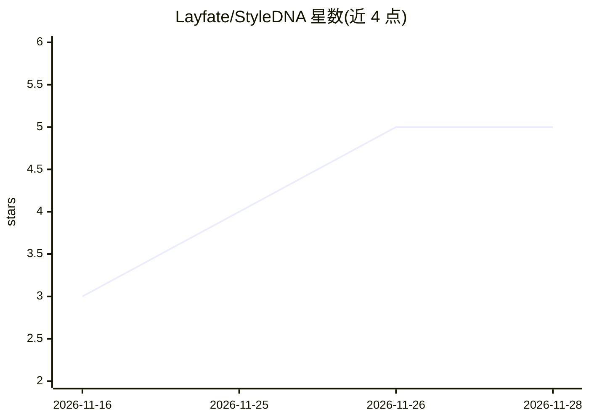

# Layfate/StyleDNA

⭐ 5 · TypeScript · MIT · 推送 2026-11-16 · [GitHub](https://github.com/Layfate/StyleDNA) · 个人维护

**把参考图分析为可复用 AI 风格技能的本地桌面应用**

本地优先的 Tauri 2/React 桌面工作台，用于收集视觉参考图、分析其风格并生成可复用的 SKILL.md 文件。核心流程为上传参考→分析风格→编辑审阅→保存/导出技能。风格度量（调色板、亮度、对比、纹理等）不依赖 AI 模型完成；可选接入本地 Ollama 视觉模型做语义解读，结果仅作建议需人工审阅。附 Python 图像处理服务与 SQLite 版本化库，另有面向 Claude Code/Cursor 等 agent 的安装版技能。无遥测、无账户、无自动上传；导出包为便携数据而非可执行插件。

## 筛选速览

| 维度 | 判定 | 备注 |
|---|---|---|
| AI 角色 | `ai-enhanced` | 去掉 AI 部分产品仍成立 |
| 许可风险 | `permissive` | MIT |
| 部署形态 | `library` | 以包/库形式分发 |
| 模型依赖 | local-ok | 支持本地模型 |
| 硬件要求 | — | 无带数字的原话,不猜 |
| 安装摩擦 | `low` | 无编译、无系统依赖或容器化 |
| 成熟度 | — | 结构信号不足 |

## 能力要点

- 无 AI 模型即可测量调色板、亮度、饱和度、对比、边缘与纹理
- 可选接入本地 Ollama 视觉模型解读视觉特征，失败不回退编造输出
- 生成确定性 SKILL.md，支持 Markdown/JSON/便携 ZIP 导出与导入
- 技能修订管理：保存、搜索、分类、标签、收藏与恢复

## 适用场景

- 从参考图提炼风格规则供 AI 绘图工具复用
- 管理带版本 revisions 的本地视觉风格技能库
- 在无网络/无云端密钥环境下做本地风格分析

## 场景标签

`图像视频处理` `图像生成` · 领域:内容生成

## 证据(README 行号)

> L32: StyleDNA is a local-first desktop workspace for collecting visual references, analyzing their style, and generating
> L39: - Measure real palettes, luminance, saturation, contrast, edges, and texture without an AI model.
> L40: - Optionally interpret visual traits with an installed **local Ollama vision model**. Results are validated suggest

## 星数曲线

2026-11-16 3 → 2026-11-28 5（+2）

---
*卡片 v1 · prompt 1.4 · 生成 2026-11-22 · 置信度 mid · 依据 README sha `c9a3527419dd` · [字段定义](../../DATASET.md)*
