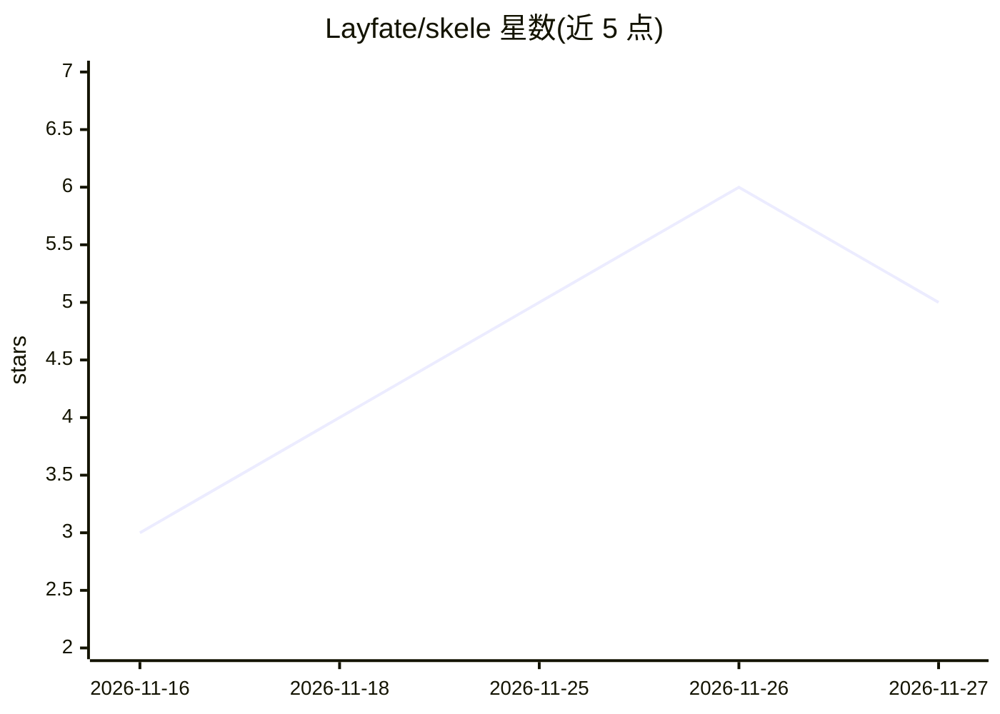

# Layfate/skele

⭐ 5 · TypeScript · MIT · 推送 2026-11-21 · [GitHub](https://github.com/Layfate/skele) · 个人维护

**本地优先的笔记/任务/数据库工作区，可选 AI 助手**

Skele 是一个本地优先、无需账号与服务器的个人工作区，覆盖嵌套页面笔记（块编辑器、wiki 链接、双链反链）、任务看板/日历和多视图数据库。数据以 Markdown 导入导出并以 SQLite 文件存储，支持完全离线运行。可选 AI workspace 允许通过已有 Claude Code / Codex 登录或 Ollama 本地模型与笔记对话，也可自带 Anthropic/OpenAI API key。桌面端基于 Tauri 提供 Windows/macOS/Linux 安装包，另有可自托管的 PWA。

## 筛选速览

| 维度 | 判定 | 备注 |
|---|---|---|
| AI 角色 | `ai-enhanced` | 去掉 AI 部分产品仍成立 |
| 许可风险 | `permissive` | MIT |
| 部署形态 | `desktop` | 安装包/桌面程序 |
| 模型依赖 | local-ok | 支持本地模型 |
| 硬件要求 | — | 无带数字的原话,不猜 |
| 安装摩擦 | `low` | 无编译、无系统依赖或容器化 |
| 成熟度 | — | 结构信号不足 |

## 能力要点

- 本地优先：无账号无服务器，工作区为本地 SQLite 文件，完全离线可用
- 可选 AI workspace：Claude / Codex / Ollama 本地模型，支持 MCP 服务器与本地回退
- Markdown 双向导入导出（兼容 Obsidian vault）与完整备份、恢复点
- 跨平台桌面安装包（含 ARM64）与可部署的静态 Web/PWA 构建

## 适用场景

- 在本地管理笔记、任务与项目数据库
- 让 AI 读取/编辑指定文件夹内的笔记（本地模型或自有 API key）
- 替代云端笔记工具的本地离线方案
- 与 Obsidian vault 互导 Markdown 数据

## 场景标签

`AI 助手` `知识库管理` · 领域:对话与助手

## 证据(README 行号)

> L10:  Free and open source, with an optional AI workspace. No account, no server: everything you write stays on your dev
> L24: Skele is a calm, fast, keyboard-first workspace for notes, tasks, projects and databases. It's
> L43: - **AI workspace (optional):** chat with Claude, Codex or a local model (Ollama) about your

## 星数曲线

2026-11-16 3 → 2026-11-27 5（+2）

---
*卡片 v1 · prompt 1.4 · 生成 2026-11-21 · 置信度 high · 依据 README sha `8c12061d872b` · [字段定义](../../DATASET.md)*
