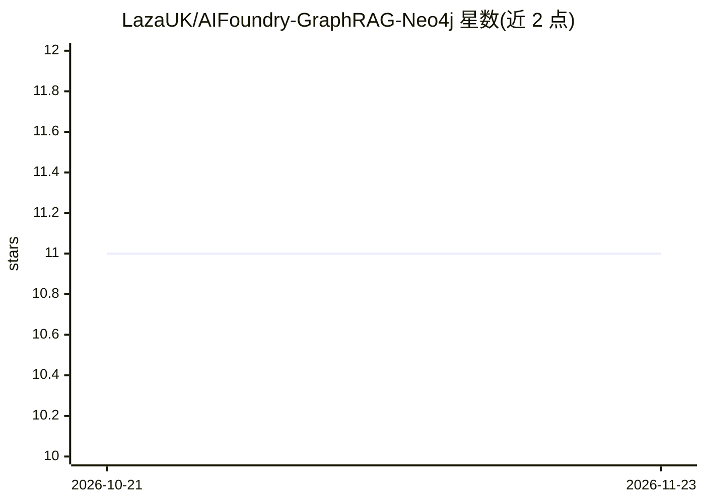

# LazaUK/AIFoundry-GraphRAG-Neo4j

⭐ 11 · Python · MIT · 推送 2026-02-12 · [GitHub](https://github.com/LazaUK/AIFoundry-GraphRAG-Neo4j) · 个人维护

**Neo4j 图数据库上的 Graph RAG 问答演示，配 Streamlit 界面**

以 Northwind 数据集为知识库的 Graph RAG 演示方案：后端提供预置数据的 Neo4j Docker 镜像（GHCR 托管），前端为 Streamlit 应用，通过 LangChain 的 GraphCypherQAChain 将自然语言翻译为 Cypher 查询，由 Azure AI Foundry 部署的模型驱动，支持多跳检索并展示生成的 Cypher 与结果可视化。使用 Entra ID 认证（DefaultAzureCredential，无静态 API key），需先完成 az login 并具备相应 RBAC 角色。也可用 /scripts 中的 Cypher 脚本手动建库。

## 筛选速览

| 维度 | 判定 | 备注 |
|---|---|---|
| AI 角色 | `ai-native` | 本体是模型或模型工具 |
| 许可风险 | `permissive` | MIT |
| 部署形态 | `self-host` | docker 或自建部署 |
| 模型依赖 | locked-api |  |
| 硬件要求 | — | 无带数字的原话,不猜 |
| 安装摩擦 | `low` | 无编译、无系统依赖或容器化 |
| 成熟度 | — | 结构信号不足 |

## 能力要点

- Neo4j 后端提供预加载 Northwind 数据集的 GHCR Docker 镜像
- GraphCypherQAChain 实现自然语言到 Cypher 的翻译
- DefaultAzureCredential 认证，无需静态 API key
- 展示生成的 Cypher 脚本与多跳检索路径

## 适用场景

- 在图数据库上体验自然语言问答（Graph RAG）
- 参考 Cypher 脚本把 CSV 数据导入 Neo4j 建图
- 搭建本地 Neo4j + Streamlit 的演示环境

## 场景标签

`RAG` `数据分析` · 领域:效率与自动化

## 证据(README 行号)

> L3: This repo demonstrates how to deploy a **Neo4j** graph database pre-loaded with the _Northwind_ dataset and use it a
> L67: The app handles the _natural-language-to-Cypher_ translation using the `GraphCypherQAChain`.

## 星数曲线

2026-10-21 11 → 2026-11-23 11（+0）

---
*卡片 v1 · prompt 1.4 · 生成 2026-11-19 · 置信度 high · 依据 README sha `0155275eaae8` · [字段定义](../../DATASET.md)*
