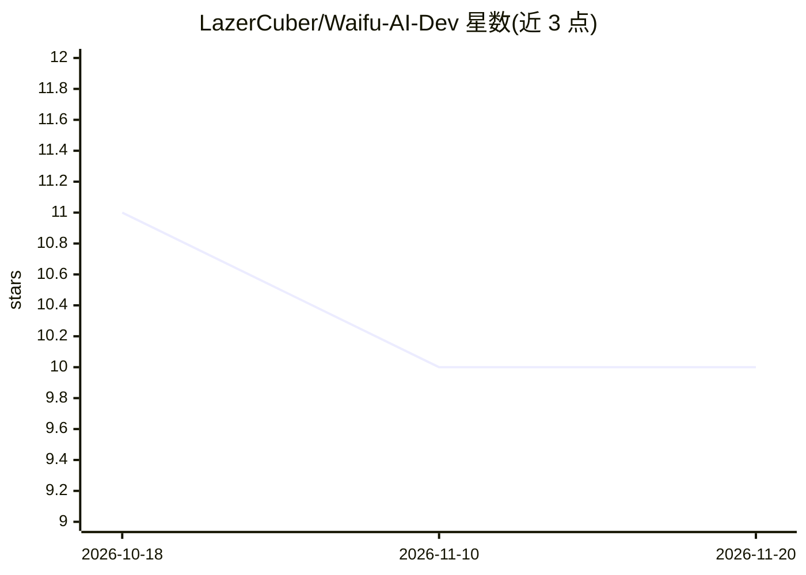

# LazerCuber/Waifu-AI-Dev

⭐ 10 · TypeScript · 推送 2026-04-05 · [GitHub](https://github.com/LazerCuber/Waifu-AI-Dev) · 个人维护

**带 TTS 语音的 Live2D 虚拟角色对话应用**

基于 Next.js/React 的 Live2D 虚拟角色应用，继承原仓库 Waifu-AI 并做性能优化：包括延迟改进、Live2D 卡顿修复、口型同步与更流畅的动作。对话由 LLM API 驱动，语音输出通过 ElevenLabs TTS 生成。需 Node 与 pnpm 环境，配置 OpenAI/Mistral/Groq（可选其一）及 ElevenLabs API key 后以开发服务器方式运行，并提示使用 Beta 分支。

## 筛选速览

| 维度 | 判定 | 备注 |
|---|---|---|
| AI 角色 | `ai-native` | 本体是模型或模型工具 |
| 许可风险 | `none` | — |
| 部署形态 | `library` | 以包/库形式分发 |
| 模型依赖 | — | README 未给出锁定关系 |
| 硬件要求 | — | 无带数字的原话,不猜 |
| 安装摩擦 | `low` | 无编译、无系统依赖或容器化 |
| 成熟度 | — | 结构信号不足 |

## 能力要点

- Live2D 模型展示与口型同步、动作平滑优化
- LLM 对话 + ElevenLabs TTS 语音输出
- 支持 ChatGPT/Mistral/Groq API key 可选配置
- 提供 gh CLI 克隆与 pnpm 开发服务器运行方式

## 适用场景

- 与 Live2D 虚拟角色进行文字与语音对话
- 自托管的动漫风格 AI 聊天伴侣应用
- 在本地开发服务器上定制 Live2D 交互体验

## 场景标签

`聊天机器人` `语音合成` · 领域:对话与助手

## 证据(README 行号)

> L3: # So what is this for?:
> L19: * ChatGPT or Groq API key (optional) (Unavailable Soon For Groq)
> L21: * ElevenLabs API key

## 星数曲线

2026-10-18 11 → 2026-11-20 10（-1）

---
*卡片 v1 · prompt 1.4 · 生成 2026-11-20 · 置信度 high · 依据 README sha `ed1c8a8bc89c` · [字段定义](../../DATASET.md)*
