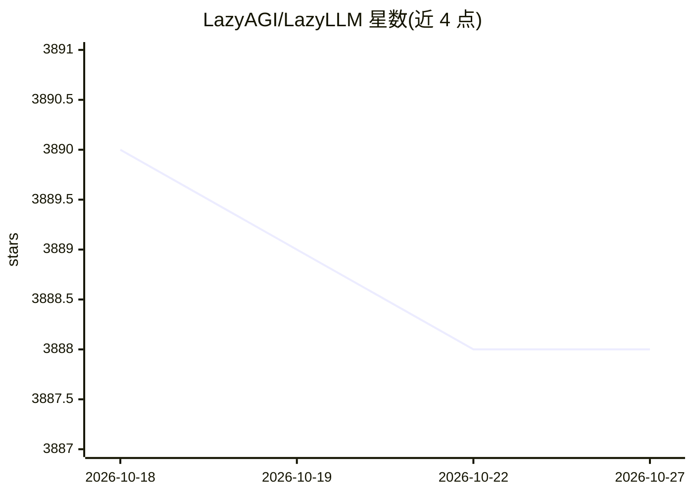

# LazyAGI/LazyLLM

⭐ 3,888 · Python · Apache-2.0 · 推送 2026-10-26 · [GitHub](https://github.com/LazyAGI/LazyLLM) · [官网](https://docs.lazyllm.ai/) · 组织维护 · 中文 README

**低代码构建多 agent LLM 应用的开发框架**

面向多 agent LLM 应用开发的低代码工具：提供 pipeline/parallel/diverter 等工作流原语、RAG 组件（Document/Retriever/Reranker）、WebModule 界面与一键部署能力，覆盖原型构建→数据反馈→迭代优化流程。统一在线模型服务（GPT/SenseNova/Kimi/智谱/通义千问）与本地模型（lightllm/vllm 推理、collie/peft 微调）的使用体验，支持按场景自动选择微调框架与模型切分策略，兼容裸机、Slurm 集群与公有云。以 pip 安装的 Python 库形式提供。

## 筛选速览

| 维度 | 判定 | 备注 |
|---|---|---|
| AI 角色 | `ai-ecosystem` | LLM/agent 周边工具 |
| 许可风险 | `permissive` | Apache-2.0 |
| 部署形态 | `library` | 以包/库形式分发 |
| 模型依赖 | local-ok | 支持本地模型 |
| 硬件要求 | — | 无带数字的原话,不猜 |
| 安装摩擦 | `low` | 无编译、无系统依赖或容器化 |
| 成熟度 | — | 结构信号不足 |

## 能力要点

- pipeline/parallel/diverter/loop 等工作流原语构建多 agent 应用
- 统一在线服务与本地模型（vllm/lightllm 推理、collie/peft 微调）体验
- 内置 Document/Retriever/Reranker 等 RAG 组件与聊天界面
- 跨 IaaS 平台（裸机/Slurm/公有云）一键切换部署

## 适用场景

- 快速搭建聊天机器人、RAG 知识库问答等多 agent 应用
- 在应用内对模型做微调并持续迭代算法效果
- 从 POC 到生产，跨平台部署与网关化发布

## 场景标签

`Agent 框架` `多智能体` `RAG` `微调` · 领域:Agent 开发

## 证据(README 行号)

> L10: LazyLLM is a low-code development tool for building **multi-agent** large language model applications. It assists d
> L125: 1. **Application Building**: Defines workflows such as pipeline, parallel, diverter, if, switch, and loop. Develop
> L130:  + Supports inference frameworks: lightllm, vllm

## 星数曲线

2026-10-18 3,890 → 2026-10-27 3,888（-2）

---
*卡片 v1 · prompt 1.4 · 生成 2026-10-20 · 置信度 high · 依据 README sha `4cdd07480ba7` · [字段定义](../../DATASET.md)*
