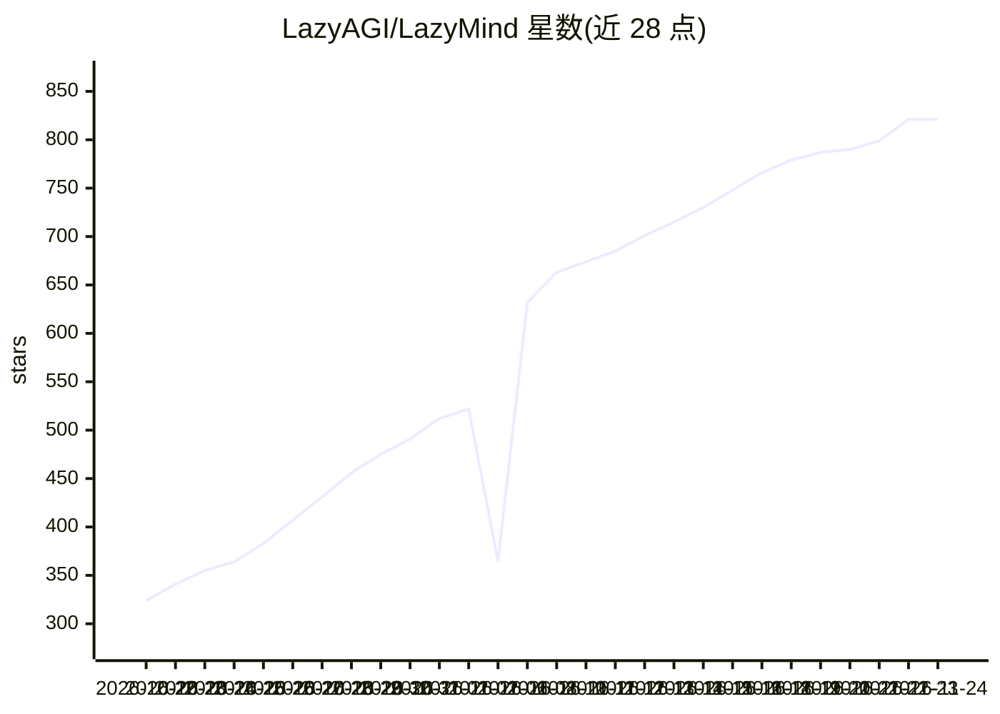

# LazyAGI/LazyMind

⭐ 821 · Go · Apache-2.0 · 推送 2026-11-20 · [GitHub](https://github.com/LazyAGI/LazyMind) · 组织维护 · 中文 README

**面向知识型工作的 AI 技能运行时：把知识变成可执行任务**

LazyMind 定位为知识密集型工作的 AI Skill Runtime，将知识、专家实践与工具组织为可执行、可恢复的工作流。核心机制包括：多源知识库（OCR 解析、混合检索、重排序、引用溯源）、以状态机定义的工作流与可编辑产物、长任务的可视化步骤/审批/重试/回退、以及基于评测的改进管线（坏例转评测样本、诊断、A/B 测试）。提供桌面模式本地使用，也可部署为团队服务，并通过 MCP 向 Codex、Cursor、DeepSeek Harness 等外部 agent 提供知识、Skills 与 Workflows。

## 筛选速览

| 维度 | 判定 | 备注 |
|---|---|---|
| AI 角色 | `ai-native` | 本体是模型或模型工具 |
| 许可风险 | `permissive` | Apache-2.0 |
| 部署形态 | `desktop` | 安装包/桌面程序 |
| 模型依赖 | locked-api |  |
| 硬件要求 | — | 无带数字的原话,不猜 |
| 安装摩擦 | `low` | 无编译、无系统依赖或容器化 |
| 成熟度 | — | 结构信号不足 |

## 能力要点

- 知识库支持本地目录、对象存储、飞书、Notion 等多源接入，含 OCR、混合检索与重排序
- 工作流以状态机定义步骤/工具/输入输出，中间产物可编辑、可审批、可从失败步骤重跑
- PPT 工作流覆盖研究→大纲→生成→审阅→导出，支持 PDF/图片型/可编辑 PPTX 导出
- evo 改进管线：坏例转评测样本，跑基线评测、诊断、修复与 A/B 测试

## 适用场景

- 本地知识工作：让 AI 从我的文档产出带引用的研究报告
- 从产品想法生成并迭代修改 PPT，中间大纲和素材可见可改
- 接入飞书/Notion 等知识源搭建团队知识助手
- 把 Codex/Cursor 等已有 agent 接上我的知识与工作流

## 场景标签

`工作流自动化` `RAG` `知识库管理` `模型评测` · 领域:效率与自动化

## 证据(README 行号)

> L15: LazyMind is an **AI Skill Runtime** for knowledge-intensive work: an environment that turns knowledge, expert pract
> L19: - **Desktop Mode** is designed for technically capable professionals whose primary job is not programming, includin
> L165: LazyMind can discover local projects and native task histories from Codex, Cursor, WorkBuddy, TRAE Work, DeepSeek 

## 星数曲线

2026-10-22 324 → 2026-11-24 821（+497）

---
*卡片 v1 · prompt 1.4 · 生成 2026-11-24 · 置信度 high · 依据 README sha `f291084a6662` · [字段定义](../../DATASET.md)*
