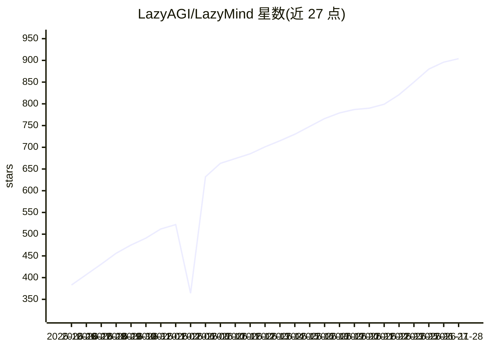

# LazyAGI/LazyMind

⭐ 904 · Go · Apache-2.0 · 推送 2026-11-27 · [GitHub](https://github.com/LazyAGI/LazyMind) · 组织维护 · 中文 README

**面向知识型工作的 AI 技能运行时，本地可控地执行工作流**

LazyMind 将知识、专家实践与工具封装为可执行、可恢复的任务环境：知识层支持本地文件、云文档与对象存储接入，经 OCR 解析与混合检索回答；工作流以状态机定义步骤、工具与状态转移，长任务中每步可见、可审批、可回滚。支持桌面模式本地运行或企业服务部署，并可通过 MCP 将知识库、Skills 与 Workflows 提供给 Codex、Cursor 等外部 agent 使用；含评估、诊断、A/B 测试的改进机制。

## 筛选速览

| 维度 | 判定 | 备注 |
|---|---|---|
| AI 角色 | `ai-native` | 本体是模型或模型工具 |
| 许可风险 | `permissive` | Apache-2.0 |
| 部署形态 | `desktop` | 安装包/桌面程序 |
| 模型依赖 | locked-api |  |
| 硬件要求 | — | 无带数字的原话,不猜 |
| 安装摩擦 | `low` | 无编译、无系统依赖或容器化 |
| 成熟度 | — | 结构信号不足 |

## 能力要点

- 工作流以状态机定义，步骤可见、可审批、可从失败步重试
- 多源知识库：PDFReader/MinerU/PaddleOCR-VL 解析，混合检索与 rerank，回答带引用
- PPT 工作流从研究、大纲审批到导出可编辑 PPTX/PDF
- 通过 MCP 向 Codex、Cursor 等外部 agent 提供 Skills/Workflows/知识库

## 适用场景

- 本地完成研究报告、文档写作并得到可追溯的交付物
- 团队共享知识库并按权限协作执行流程
- 从想法生成并逐页编辑演示文稿后导出
- 让已有的 Codex/Cursor 会话调用组织知识和工作流

## 场景标签

`工作流自动化` `RAG` `文档问答` · 领域:效率与自动化

## 证据(README 行号)

> L18: LazyMind is an **AI Skill Runtime** for knowledge-intensive work: an environment that turns knowledge, expert pract
> L20: Instead of repeatedly uploading context, tuning prompts, and supervising every agent step, you choose the knowledge
> L168: LazyMind can discover local projects and native task histories from Codex, Cursor, WorkBuddy, TRAE Work, DeepSeek 

## 星数曲线

2026-10-26 383 → 2026-11-28 904（+521）

---
*卡片 v1 · prompt 1.4 · 生成 2026-11-27 · 置信度 high · 依据 README sha `5d129d37fd4c` · [字段定义](../../DATASET.md)*
