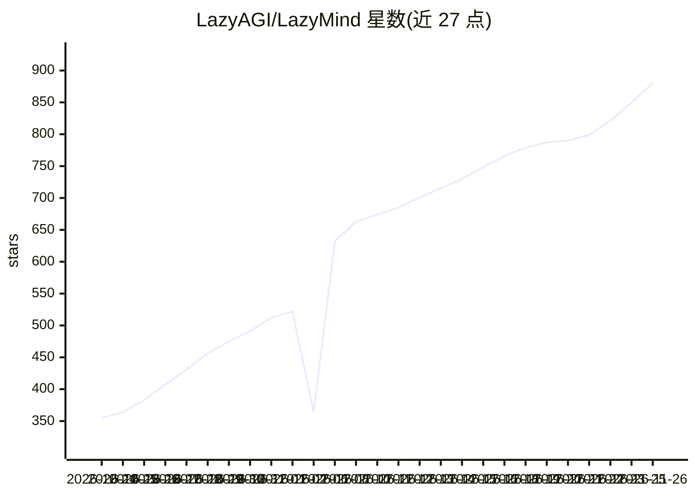

# LazyAGI/LazyMind

⭐ 880 · Go · Apache-2.0 · 推送 2026-11-25 · [GitHub](https://github.com/LazyAGI/LazyMind) · 组织维护 · 中文 README

**本地优先的 AI 技能运行时，把知识、技能与工作流变成可审计交付物**

LazyMind 定位为面向知识密集型工作的 AI Skill Runtime：将本地文件、云文档、对象存储、飞书、Notion 等来源统一为知识库，经解析/OCR/混合检索/重排后支撑技能与工作流执行。工作流以状态机定义步骤、审批检查点、可编辑工件与版本回溯；知识侧含偏好/术语沉淀与 evo 评测诊断、A/B 与回滚。支持桌面模式本地运行或部署为企业共享服务，并通过 MCP 向 Codex、Cursor 等外部 agent 开放知识、技能与工作流。

## 筛选速览

| 维度 | 判定 | 备注 |
|---|---|---|
| AI 角色 | `ai-native` | 本体是模型或模型工具 |
| 许可风险 | `permissive` | Apache-2.0 |
| 部署形态 | `desktop` | 安装包/桌面程序 |
| 模型依赖 | — | README 未给出锁定关系 |
| 硬件要求 | — | 无带数字的原话,不猜 |
| 安装摩擦 | `low` | 无编译、无系统依赖或容器化 |
| 成熟度 | — | 结构信号不足 |

## 能力要点

- 以状态机工作流执行长任务，支持审批检查点、失败步骤重跑与版本回溯
- 多源知识库：PDFReader/MinerU/PaddleOCR-VL 解析，混合检索、重排与行内引用
- PPT 工作流产出可编辑 PPTX/PDF，中间大纲与素材全程可见可改
- 经 MCP 向外部 agent（Codex/Cursor 等）开放工作流、技能与知识库

## 适用场景

- 从检索到审核生成可溯源的研究报告
- 从想法经大纲审批生成可编辑演示文稿
- 接入飞书/Notion 等来源搭建团队知识助手
- 把专家实践封装为可版本化、可回滚的工作流

## 场景标签

`工作流自动化` `RAG` `OCR` · 领域:效率与自动化

## 证据(README 行号)

> L17: LazyMind is an **AI Skill Runtime** for knowledge-intensive work: an environment that turns knowledge, expert pract
> L19: Instead of repeatedly uploading context, tuning prompts, and supervising every agent step, you choose the knowledge
> L21: - **Desktop Mode** is designed for technically capable professionals whose primary job is not programming, includin

## 星数曲线

2026-10-24 355 → 2026-11-26 880（+525）

---
*卡片 v1 · prompt 1.4 · 生成 2026-11-26 · 置信度 high · 依据 README sha `a338d9594abd` · [字段定义](../../DATASET.md)*
