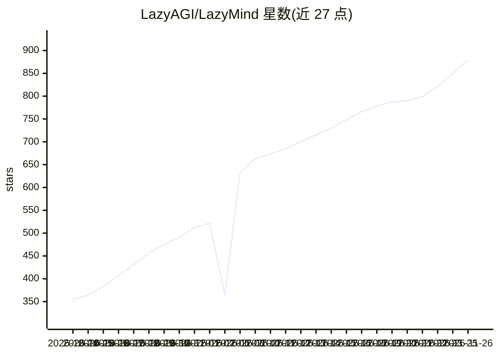

# LazyAGI/LazyMind

⭐ 880 · Go · Apache-2.0 · 推送 2026-11-25 · [GitHub](https://github.com/LazyAGI/LazyMind) · 组织维护 · 中文 README

**知识型工作者的 AI 技能运行时：将知识、技能与工作流组织为可执行任务**

LazyMind 定位为面向知识密集型工作的 AI Skill Runtime，将知识库、可复用 Skills、可观测工作流、可编辑产物与评估改进整合在同一工作区。核心机制包括：多源知识摄入（本地文件、对象存储、飞书、Notion）配合 OCR 与混合检索、以状态机定义的工作流执行（步骤可见、检查点审批、失败步重跑、版本回滚）、以及通过 evo 做坏例评估与 A/B 测试。桌面模式本地运行，也可作为企业服务部署，或经 MCP 供外部 agent 调用其知识、Skills 与工作流。

## 筛选速览

| 维度 | 判定 | 备注 |
|---|---|---|
| AI 角色 | `ai-native` | 本体是模型或模型工具 |
| 许可风险 | `permissive` | Apache-2.0 |
| 部署形态 | `desktop` | 安装包/桌面程序 |
| 模型依赖 | — | README 未给出锁定关系 |
| 硬件要求 | — | 无带数字的原话,不猜 |
| 安装摩擦 | `low` | 无编译、无系统依赖或容器化 |
| 成熟度 | — | 结构信号不足 |

## 能力要点

- 知识库多源接入：本地目录、对象存储、飞书、Notion，PDFReader/MinerU/PaddleOCR-VL 解析文档
- 工作流以状态机定义，支持步骤审批、中间产物编辑、从失败步重跑与版本回滚
- PPT 工作流从选题到导出 PDF/图片型/可编辑 PPTX，中间结果全程可见可改
- 通过 MCP 向 Codex、Cursor、DeepSeek Harness 等外部 agent 开放知识、Skills 与工作流

## 适用场景

- 基于自有文档生成带引用溯源的研究报告
- 从产品想法走完调研、PRD 到幻灯片导出的流程
- 团队把专家经验固化为可发布、可版本化的工作流
- 让已有的 Codex/Cursor 会话直接调用团队知识库与工作流

## 场景标签

`工作流自动化` `RAG` `模型评测` · 领域:效率与自动化

## 证据(README 行号)

> L17: LazyMind is an **AI Skill Runtime** for knowledge-intensive work: an environment that turns knowledge, expert pract
> L21: - **Desktop Mode** is designed for technically capable professionals whose primary job is not programming, includin
> L167: LazyMind can discover local projects and native task histories from Codex, Cursor, WorkBuddy, TRAE Work, DeepSeek 

## 星数曲线

2026-10-24 355 → 2026-11-26 880（+525）

---
*卡片 v1 · prompt 1.4 · 生成 2026-11-25 · 置信度 high · 依据 README sha `9e9e0ab9a00d` · [字段定义](../../DATASET.md)*
