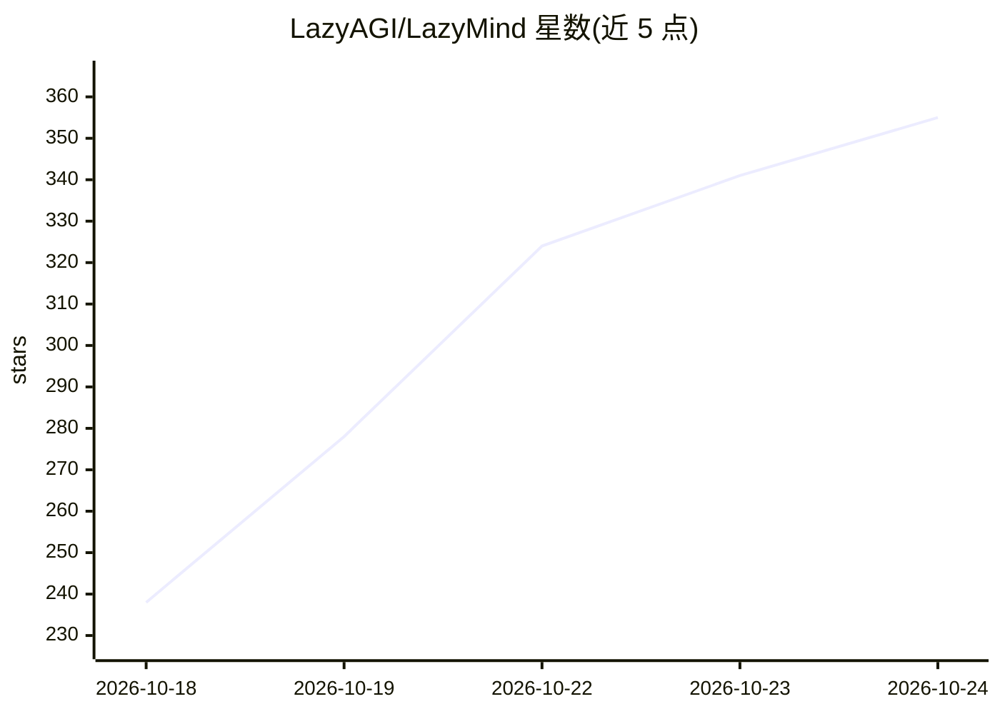

# LazyAGI/LazyMind

⭐ 364 · Go · Apache-2.0 · 推送 2026-10-23 · [GitHub](https://github.com/LazyAGI/LazyMind) · 组织维护 · 中文 README

**面向知识密集工作的 AI Skill 运行时，交付可编辑成果**

LazyMind 是一个 AI Skill Runtime，将知识库、可执行 Skills、工作流与产物管理整合在同一工作区：支持多源知识接入（本地文件、Feishu、Notion、对象存储）、OCR/解析、混合检索与重排，以状态机工作流执行长任务，中间步骤可见、可审批、可回退，产物保留版本历史。提供桌面模式（macOS/Windows）与企业部署模式，并可通过 MCP 让 Codex、Cursor、DeepSeek Harness 等外部 agent 复用其知识与工作流。含 PPT 生成、文档内问答、坏例评估改进（evo）等场景。

## 筛选速览

| 维度 | 判定 | 备注 |
|---|---|---|
| AI 角色 | `ai-native` | 本体是模型或模型工具 |
| 许可风险 | `permissive` | Apache-2.0 |
| 部署形态 | `desktop` | 安装包/桌面程序 |
| 模型依赖 | — | README 未给出锁定关系 |
| 硬件要求 | — | 无带数字的原话,不猜 |
| 安装摩擦 | `low` | 无编译、无系统依赖或容器化 |
| 成熟度 | — | 结构信号不足 |

## 能力要点

- 状态机工作流：步骤可见、可审批、可从失败步骤重跑，产物可编辑并保留版本
- 多源知识库：本地/云文档/对象存储接入，解析、OCR、混合检索、重排与引用溯源
- 通过 MCP 向 Codex、Cursor、DeepSeek Harness 等外部 agent 提供工作流、Skills 与知识库
- evo 评估管线：坏例转为评估样本，经基线评估、诊断、修复与 A/B 测试后上线

## 适用场景

- 技术型非编程专业人员（架构师、产品经理等）在本地完成调研、写作与演示文稿等知识工作
- 团队/企业共享知识与工作流，做二次开发、项目交付与组织知识协作
- 让已在使用的 agent（如 Codex、DeepSeek Harness）复用统一的知识库与可执行工作流
- 将坏例沉淀为评估样本，验证改进后再发布

## 场景标签

`工作流自动化` `RAG` `文档解析` `知识库管理` · 领域:效率与自动化

## 证据(README 行号)

> L15: LazyMind is an **AI Skill Runtime** for knowledge-intensive work: an environment that turns knowledge, expert pract
> L17: Instead of repeatedly uploading context, tuning prompts, and supervising every agent step, you choose the knowledge
> L41: |**Knowledge assistant**|Connect sources → parse/OCR → hybrid retrieve → rerank → answer|Answers linked back to reu

## 星数曲线

2026-10-18 238 → 2026-10-24 355（+117）

---
*卡片 v1 · prompt 1.4 · 生成 2026-10-21 · 置信度 high · 依据 README sha `5f37c1d39268` · [字段定义](../../DATASET.md)*
