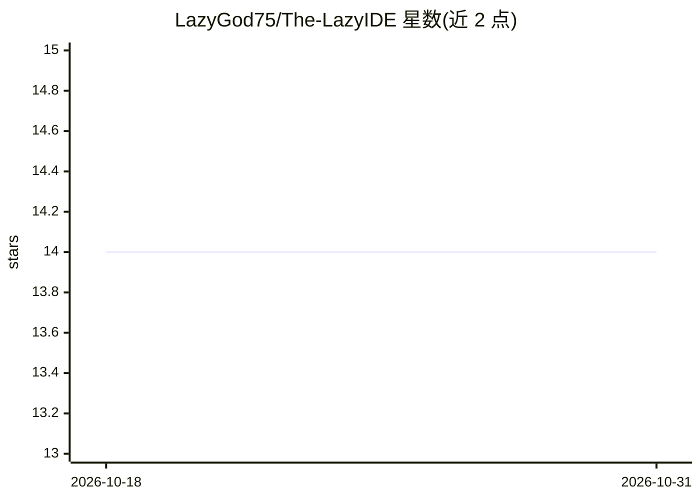

# LazyGod75/The-LazyIDE

⭐ 14 · TypeScript · NOASSERTION · 推送 2026-09-21 · [GitHub](https://github.com/LazyGod75/The-LazyIDE) · 个人维护

**给开发者的桌面 AI IDE：一个 AI 管理者规划并调度 agent 舰队干活**

基于 Tauri 2 + React 的桌面 IDE/harness：用户向一个 LazyManager（AI 管理者）下达任务简报，它制定编号计划图并委派给多个 agent 与定时运行例程的 LazyBots（含 Solari 浏览器自动化）。配套持久化 Brain 项目记忆（磁盘 HTML 神经元 + SQLite FTS5 + 本地 ONNX 嵌入，确定性召回）、实时 canvas 仪表盘、双评审官 diff 审查与团队共享脑。模型接入三种方式：托管订阅（Claude/GPT）、BYOK（Anthropic/OpenRouter/DeepSeek 等）或复用已登录的 claude/codex/devin CLI。从源码需 Node 20.12+ 与 Rust；安装器尚未发布时通过 npm start 运行。

## 筛选速览

| 维度 | 判定 | 备注 |
|---|---|---|
| AI 角色 | `ai-native` | 本体是模型或模型工具 |
| 许可风险 | `none` | NOASSERTION |
| 部署形态 | `None` |  |
| 模型依赖 | — | README 未给出锁定关系 |
| 硬件要求 | — | 无带数字的原话,不猜 |
| 安装摩擦 | `low` | 无编译、无系统依赖或容器化 |
| 成熟度 | — | 结构信号不足 |

## 能力要点

- LazyManager 以编号计划图（并行分支/汇合点）规划并监督 agent 执行，重试卡死步骤
- Brain 持久记忆：HTML 神经元文件 + SQLite FTS5 + 本地 ONNX 嵌入，确定性上下文注入
- LazyBots 按计划运行例程（PR 巡检、回归测试等），经 Solari 做浏览器自动化
- 双评审官对照 Brain 规则审读真实 git diff 后合并；支持 BYOK 或复用已有 CLI 订阅

## 适用场景

- 用一句话简报让 AI 管理者规划并调度多个 agent 完成编码任务
- 让项目决策与规则在 agent 会话间持久沉淀并被自动注入
- 定时运行 PR 巡检、回归测试等例程的机器人化工作流

## 场景标签

`编码 Agent` `工作流自动化` `Agent 记忆` `浏览器自动化` · 领域:Agent 开发

## 证据(README 行号)

> L29: Lazy is an IDE/harness where you talk to **one AI manager** and it does all the
> L216:  subscription for managed models (Claude, GPT) with transparent per-token

## 星数曲线

2026-10-18 14 → 2026-10-31 14（+0）

---
*卡片 v1 · prompt 1.4 · 生成 2026-10-31 · 置信度 high · 依据 README sha `de30cfcad1b6` · [字段定义](../../DATASET.md)*
