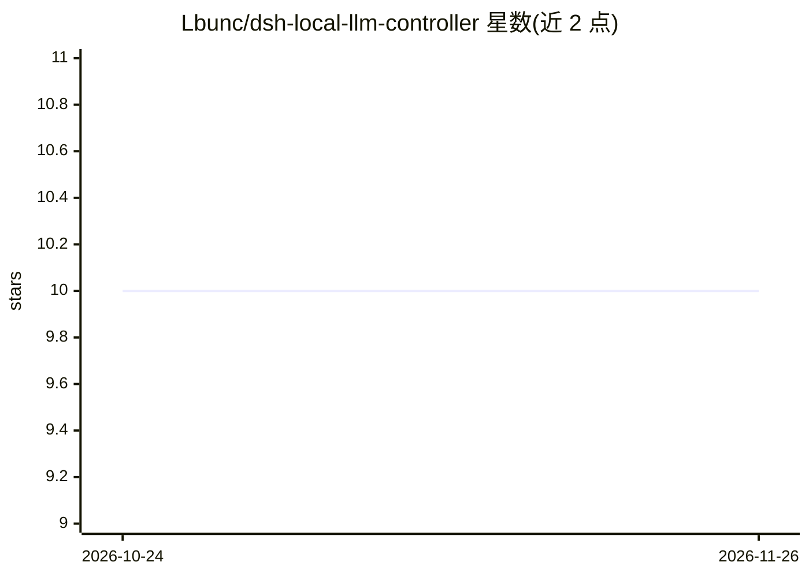

# Lbunc/dsh-local-llm-controller

⭐ 10 · JavaScript · MIT · 推送 2026-11-21 · [GitHub](https://github.com/Lbunc/dsh-local-llm-controller) · 个人维护 · 中文 README

**DSH 插件：设置页一键启停本地 llama.cpp 模型**

面向 DSH 用户（v0.1.7-rc.1 分支）的插件，在设置→插件页以卡片形式提供 llama-server 的启动/停止控制与状态、日志展示。机制上支持双槽位模型文件夹扫描 GGUF 候选、自动识别 mmproj 视觉投影器、八组启动参数（槽位×文本/视觉×快速/长上下文），并可将选中模型一键写入 DSH 模型页供会话调用。v2.1.2 起附 LocalCompactionEngine 本地压缩引擎，面向 32k~256k 窗口的比例阈值与尾部封顶机制。插件本身不含 llama-server 与模型文件，需自备上游组件；仅适配 DSH RC 分支。

## 筛选速览

| 维度 | 判定 | 备注 |
|---|---|---|
| AI 角色 | `ai-ecosystem` | LLM/agent 周边工具 |
| 许可风险 | `permissive` | MIT |
| 部署形态 | `library` | 以包/库形式分发 |
| 模型依赖 | local-ok | 支持本地模型 |
| 硬件要求 | — | 无带数字的原话,不猜 |
| 安装摩擦 | `low` | 无编译、无系统依赖或容器化 |
| 成熟度 | — | 结构信号不足 |

## 能力要点

- 设置页一键启停 llama-server，状态/错误/日志同卡显示
- 双槽位管理 GGUF 模型文件夹，mmproj 视觉模式自动挂载
- 八组启动参数（槽位×模态×快速/长上下文），一键写入 DSH 模型页
- LocalCompactionEngine 本地压缩引擎，含摘要三级降级与溢出恢复

## 适用场景

- 在 DSH 会话中切换使用本地 GGUF 模型对话
- 为文本与视觉场景分别维护快速/长上下文两套启动参数
- 本地长上下文窗口下替换 DSH 内置压缩引擎

## 场景标签

`推理引擎` · 领域:训练与推理

## 证据(README 行号)

> L5: **DSH 插件：在设置页一键启停本地 llama.cpp 服务，使本地大模型成为 DSH 会话模型**
> L27: > 本插件仅承担 DSH 与 llama.cpp 之间的连接与控制：不包含 llama-server 本体，也不负责模型下载。二者分别来自上游 llama.cpp 与社区量化发布（如 Hugging Face）。

## 星数曲线

2026-10-24 10 → 2026-11-26 10（+0）

---
*卡片 v1 · prompt 1.4 · 生成 2026-11-20 · 置信度 high · 依据 README sha `82a05d0e5361` · [字段定义](../../DATASET.md)*
