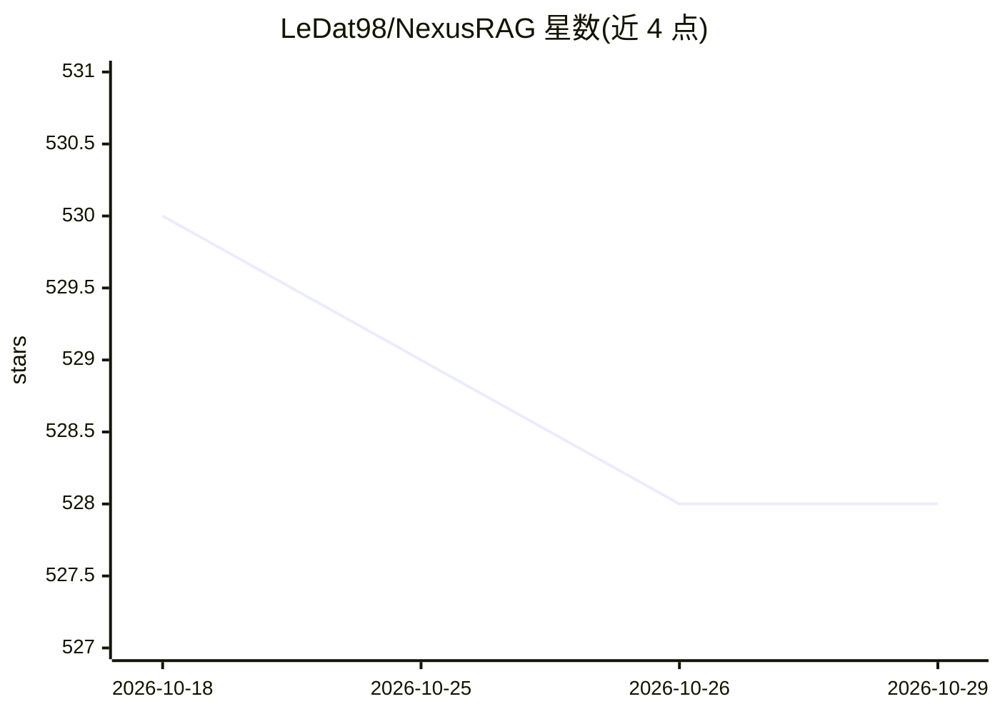

# LeDat98/NexusRAG

⭐ 528 · Python · 推送 2026-04-20 · [GitHub](https://github.com/LeDat98/NexusRAG) · 个人维护

**带引用与知识图谱的混合 RAG 知识库问答系统**

面向构建知识库问答的用户：上传 PDF/DOCX/PPTX 等文档，经 Docling 或 Marker 解析（保留标题、页码、公式结构），图像与表格由视觉 LLM 生成描述并嵌入向量；检索为三路并行——bge-m3 向量检索（ChromaDB）+ LightRAG 知识图谱实体查找 + bge-reranker-v2-m3 交叉编码器重排。回答带 4 字符内联引用，可跳转到文档查看器对应位置；聊天为半 Agent 架构、SSE 流式。LLM 可选 Gemini 云端或本地 Ollama，KG 嵌入可完全本地（sentence-transformers）。前端 React、后端 FastAPI，Docker 提供。限制：Docling 公式富化需约 18-20GB 显存，小模型（4B）在复杂文档上可能抽取不到实体。

## 筛选速览

| 维度 | 判定 | 备注 |
|---|---|---|
| AI 角色 | `ai-native` | 本体是模型或模型工具 |
| 许可风险 | `permissive` | — |
| 部署形态 | `self-host` | docker 或自建部署 |
| 模型依赖 | local-ok | 支持本地模型 |
| 硬件要求 | — | 无带数字的原话,不猜 |
| 安装摩擦 | `low` | 无编译、无系统依赖或容器化 |
| 成熟度 | — | 结构信号不足 |

## 能力要点

- 向量检索 + LightRAG 知识图谱 + 交叉编码器重排的三路混合检索
- Docling/Marker 双解析器，保留标题层级、页码与公式结构
- 图像/表格由 LLM 生成描述并嵌入向量，可随文本检索
- 内联 4 字符引用，含页码、标题路径，可跳转文档原文

## 适用场景

- 上传企业文档建带引用溯源的知识库问答
- 在图表密集的报告中通过描述检索图片和表格
- 用本地 Ollama + sentence-transformers 搭全离线 RAG

## 场景标签

`文档问答` `RAG` · 领域:知识与检索

## 证据(README 行号)

> L12: **Upload documents. Ask questions. Get cited answers.**
> L14: NexusRAG combines vector search, knowledge graph, and cross-encoder reranking into one seamless RAG pipeline — powe
> L28: Most RAG systems follow a simple pipeline: split text → embed → retrieve → generate. NexusRAG goes further at every

## 星数曲线

2026-10-18 530 → 2026-10-29 528（-2）

---
*卡片 v1 · prompt 1.4 · 生成 2026-10-21 · 置信度 high · 依据 README sha `4f0ea15b9481` · [字段定义](../../DATASET.md)*
