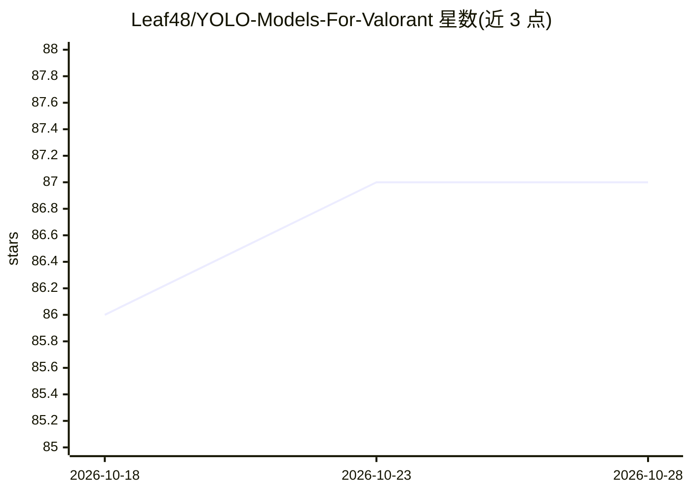

# Leaf48/YOLO-Models-For-Valorant

⭐ 87 · 推送 2026-01-07 · [GitHub](https://github.com/Leaf48/YOLO-Models-For-Valorant) · 个人维护

**面向 Valorant 游戏的 YOLOv5/YOLOv7 检测模型集**

提供针对游戏 Valorant 训练的 YOLO 系列目标检测模型，README 以表格形式列出 YOLOv5n、YOLOv5s、YOLOv7s 三种规格的支持状态、版本号与适用游戏（其中 YOLOv5s 标注同时适用于 Krunker）。仓库主题标签包含 onnx 与 tensorrt，表明模型以这些格式分发。README 内容极少，无安装说明、无使用方法描述，作者还列举了 Apex Legends 等其他游戏作为可能的其他项目方向。

## 筛选速览

| 维度 | 判定 | 备注 |
|---|---|---|
| AI 角色 | `ai-native` | 本体是模型或模型工具 |
| 许可风险 | `none` | — |
| 部署形态 | `None` |  |
| 模型依赖 | — | README 未给出锁定关系 |
| 硬件要求 | — | 无带数字的原话,不猜 |
| 安装摩擦 | `low` | 无编译、无系统依赖或容器化 |
| 成熟度 | — | 结构信号不足 |

## 能力要点

- 提供 YOLOv5n/YOLOv5s/YOLOv7s 三种规格的模型
- YOLOv5s 版本标注同时适用于 Valorant 与 Krunker
- 主题标签含 onnx 与 tensorrt 格式

## 适用场景

- 获取针对 Valorant 画面训练的 YOLO 检测模型
- 基于 ONNX/TensorRT 格式在自有环境中运行推理

## 场景标签

`目标检测` · 领域:感知与多模态

## 证据(README 行号)

> L1: ||YOLOv5n|YOLOv5s|YOLOv7s|
> L3: |Supported|✅|✅|✅|
> L5: |Game|Valorant|Valorant/Krunker|Valorant|

## 星数曲线

2026-10-18 86 → 2026-10-28 87（+1）

---
*卡片 v1 · prompt 1.4 · 生成 2026-10-24 · 置信度 mid · 依据 README sha `204e5458bd09` · [字段定义](../../DATASET.md)*
