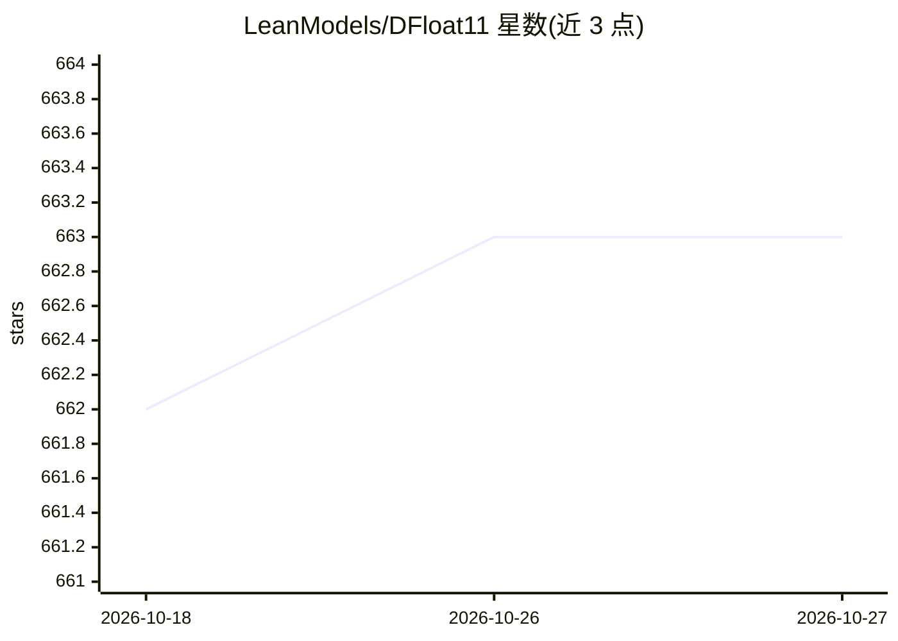

# LeanModels/DFloat11

⭐ 663 · Python · Apache-2.0 · 推送 2025-11-24 · [GitHub](https://github.com/LeanModels/DFloat11) · 组织维护

**LLM 与扩散模型的无损压缩推理框架，省约30%显存**

DFloat11 是面向 LLM 与扩散模型（FLUX.1、Qwen-Image、Wan2.1 等）的无损压缩框架：用 Huffman 编码压缩 BFloat16 指数位，权重在 GPU 显存中保持压缩态、矩阵乘法前即时解压，输出与原模型逐位一致，体积约减 30%。以 pip 包提供，支持 CPU offloading（一次仅在 GPU 保留一个 transformer block）与自行压缩 BFloat16 模型（compress_model）。要求 CUDA 12 GPU 与 PyTorch；batch=1 时推理约为原 BF16 模型的 2 倍延迟，batch 增大差距缩小。由 Rice University 与 xMAD.ai 团队维护，论文被 NeurIPS 2025 接收。

## 筛选速览

| 维度 | 判定 | 备注 |
|---|---|---|
| AI 角色 | `ai-ecosystem` | LLM/agent 周边工具 |
| 许可风险 | `permissive` | Apache-2.0 |
| 部署形态 | `library` | 以包/库形式分发 |
| 模型依赖 | — | README 未给出锁定关系 |
| 硬件要求 | — | 无带数字的原话,不猜 |
| 安装摩擦 | `medium` | 含编译或系统依赖之一 |
| 成熟度 | — | 结构信号不足 |

## 能力要点

- Huffman 编码 BFloat16 指数位的无损压缩，输出与原模型逐位一致
- 解压全部在 GPU 上进行，无需 CPU 解压与主机-设备传输，解压开销与 batch size 无关
- CPU offloading 将 FLUX.1-Krea-dev 峰值显存从 17.5GB 降至 9.8GB、Qwen3-8B 从 12.4GB 降至 2.3GB
- 提供 compress_model 工具压缩任意 BFloat16 模型，Model Hub 收录 Qwen3/Gemma3/Llama3.1/DeepSeek R1 蒸馏等预压缩模型

## 适用场景

- 在 24GB 显存以下 GPU 上运行 FLUX.1 等大模型
- 降低 LLM 推理峰值显存以部署到资源受限硬件
- 对自有 BFloat16 模型做无损压缩后再推理

## 场景标签

`推理引擎` `模型量化` · 领域:训练与推理

## 证据(README 行号)

> L7: **DFloat11** is a lossless compression framework that reduces the size of Large Language Models (LLMs) and diffusion
> L45: ## 🔍 How It Works
> L51: * **No CPU decompression or host-device data transfer**: all operations are handled entirely on the GPU.

## 星数曲线

2026-10-18 662 → 2026-10-27 663（+1）

---
*卡片 v1 · prompt 1.4 · 生成 2026-10-22 · 置信度 high · 依据 README sha `e128c4c94e39` · [字段定义](../../DATASET.md)*
