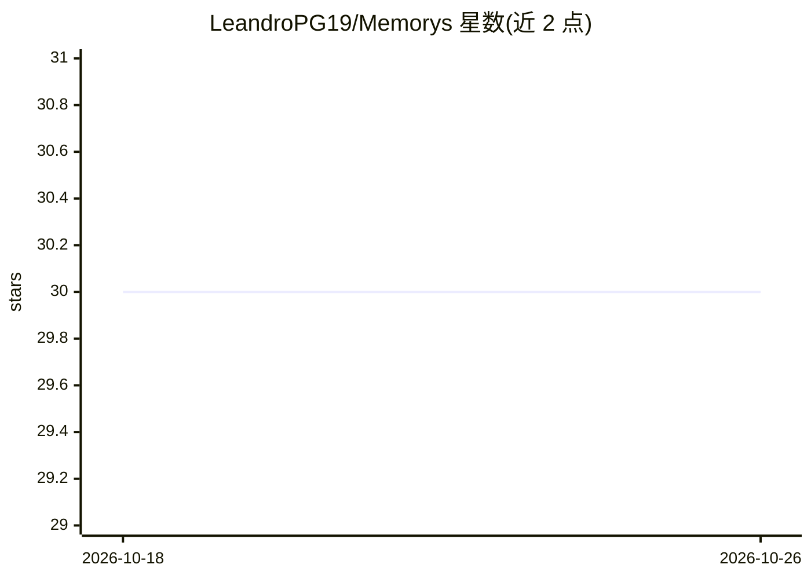

# LeandroPG19/Memorys

⭐ 30 · Rust · Apache-2.0 · 推送 2026-10-21 · [GitHub](https://github.com/LeandroPG19/Memorys) · [官网](https://registry.modelcontextprotocol.io) · 个人维护

**给 AI 编程 agent 的持久记忆 MCP 服务器（Rust + PostgreSQL/pgvector）**

为 AI 编程 agent 提供长期记忆的 MCP 服务器，用 Rust 编写，以 PostgreSQL + pgvector 为后端，提供 31 个 MCP 工具（含 CUBA_DOCS 时 32 个）、28 个 CLI 命令。核心机制：知识图谱与混合检索（词法/BM25/语义嵌入）、矛盾检测、情景记忆与前瞻触发、贝叶斯校准。首次运行通过 Docker 自动拉起 PostgreSQL 18 + pgvector 容器（Docker 须在运行）；可运行共享 daemon 替代每个客户端一个进程以省内存。模型（嵌入/NLI/reranker）可选安装，无模型时退化为无语义的 hash 嵌入；GPU reranker 需 --features cuda 构建的二进制。

## 筛选速览

| 维度 | 判定 | 备注 |
|---|---|---|
| AI 角色 | `ai-ecosystem` | LLM/agent 周边工具 |
| 许可风险 | `permissive` | Apache-2.0 |
| 部署形态 | `library` | 以包/库形式分发 |
| 模型依赖 | — | README 未给出锁定关系 |
| 硬件要求 | `cpu-ok` | |
| 安装摩擦 | `high` | 编译与系统依赖俱全 |
| 成熟度 | — | 结构信号不足 |

## 能力要点

- 31 个 MCP 工具（32 含 CUBA_DOCS）+ 28 个 CLI 命令，Rust 实现
- 首次运行自动经 Docker 拉起 PostgreSQL 18 + pgvector 并初始化 schema
- 共享 daemon（serve）让多客户端共用一份模型内存，loopback HTTP + 配对/鉴权机制
- 三档 CUBA_MODE（local/red/completo）统一设定数据库、模型与外联网络，支持多机共享记忆

## 适用场景

- 让编程 agent 跨会话记住代码库上下文，不再重复遗忘
- 多编辑器窗口/多机共享同一记忆库（Neon/Supabase 或 git 同步）
- 对 agent 记忆做溯源、矛盾检测与审计（RLS + append-only audit）

## 场景标签

`Agent 记忆` `知识图谱` · 领域:Agent 开发

## 证据(README 行号)

> L13: **Long-term memory for AI coding agents.** An MCP server that gives your agent a knowledge graph it can search, rea
> L15: Written in Rust. Backed by PostgreSQL + pgvector. **31 MCP tools** (32 with `CUBA_DOCS=1`), **28 CLI commands**, an

## 星数曲线

2026-10-18 30 → 2026-10-26 30（+0）

---
*卡片 v1 · prompt 1.4 · 生成 2026-10-26 · 置信度 high · 依据 README sha `12e6f1ff3d76` · [字段定义](../../DATASET.md)*
