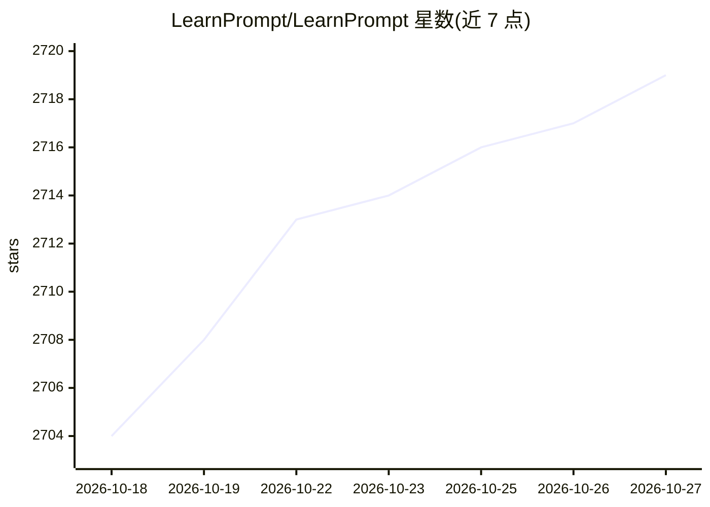

# LearnPrompt/LearnPrompt

⭐ 2,719 · MDX · NOASSERTION · 推送 2026-10-26 · [GitHub](https://github.com/LearnPrompt/LearnPrompt) · [官网](https://www.learnprompt.pro/) · 个人维护 · 中文 README

**永久免费开源的中文 AI 实战教程站（LearnPrompt）**

由卡尔（AI 沃茨）个人维护的中文 AI 学习路径项目，官网 learnprompt.pro。教程主题覆盖 Claude Code、Codex、OpenClaw、Hermes、提示语工程、ChatGPT、RAG、Agent、Midjourney、Runway、Stable Diffusion、数字人、AI 声音音乐与大模型微调等。README 同时作为 GitHub 账号主页，介绍其衍生项目（AI News Radar、鲁班等班门家族 skills、Humanize PPT、Carl Skills 等）并声明教程将升级为面向真实任务的 AI native 教程，保持免费开源。

## 筛选速览

| 维度 | 判定 | 备注 |
|---|---|---|
| AI 角色 | `ai-knowledge` | 知识聚合/清单类 |
| 许可风险 | `none` | NOASSERTION |
| 部署形态 | `None` |  |
| 模型依赖 | — | README 未给出锁定关系 |
| 硬件要求 | — | 无带数字的原话,不猜 |
| 安装摩擦 | `low` | 无编译、无系统依赖或容器化 |
| 成熟度 | `idea` | |

## 能力要点

- 中文 AI 学习路径，覆盖提示语工程、Agent、AI 编程、绘图视频工具与大模型微调
- 声明永久免费开源，并将升级为可被 AI 工作流持续维护的教程
- 配套多个衍生 skills 项目（信息雷达、PPT、班门家族等）

## 适用场景

- 第一次系统学习 AI 的中文用户按路径入门
- 查找 Claude Code、Codex 等工具的中文教程
- 关注作者各 AI skills 项目的动态与入口

## 场景标签

`教程课程` · 领域:学习与行业

## 证据(README 行号)

> L19: **LearnPrompt · 永久免费开源的中文AI实战教程**
> L21: LearnPrompt是我的来时路，也是这个账号最早的公共项目。它是一套持续维护的中文AI学习路径，覆盖Claude Code，Codex，OpenClaw，Hermes，提示语工程，ChatGPT，RAG，Agent，AI编程，
> L129: 这里既是GitHub账号`LearnPrompt`的默认Profile README，也是LearnPrompt开源AI教程站的项目仓库。

## 星数曲线

2026-10-18 2,704 → 2026-10-27 2,719（+15）

---
*卡片 v1 · prompt 1.4 · 生成 2026-10-21 · 置信度 high · 依据 README sha `ebea23e1f19c` · [字段定义](../../DATASET.md)*
