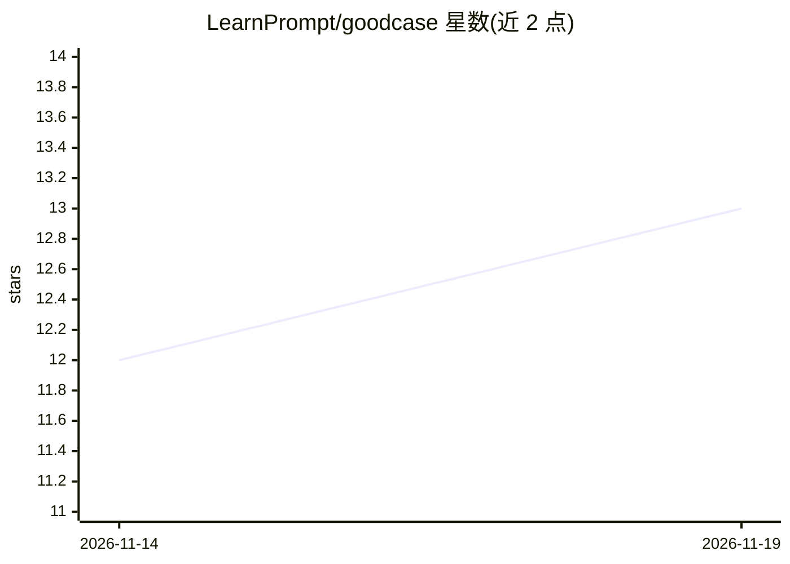

# LearnPrompt/goodcase

⭐ 13 · TypeScript · MIT · 推送 2026-11-18 · [GitHub](https://github.com/LearnPrompt/goodcase) · [官网](https://goodcase.ai/?utm_source=goodcase-repo&utm_medium=github&utm_campaign=repo-home) · 组织维护 · 中文 README

**AI 案例站点 goodcase.ai 的开源版：clone 即跑同款 UI**

goodcase.ai 的开源站点部分，提供完整前台 UI（首页、案例库筛选/搜索、案例详情、创作者页、每日早报）并内置一组真实样例案例（含完整提示词与媒体）。无需配置环境变量与数据库即可运行，接入 Supabase 后可切换为自己的数据。另提供公开 Agent API（/api/public/cases），线上数据供给、审核后台与采集系统不在仓库内。标准 Next.js 应用，可部署到 Vercel 等 Node.js 平台。

## 筛选速览

| 维度 | 判定 | 备注 |
|---|---|---|
| AI 角色 | `ai-enhanced` | 去掉 AI 部分产品仍成立 |
| 许可风险 | `permissive` | MIT |
| 部署形态 | `library` | 以包/库形式分发 |
| 模型依赖 | — | README 未给出锁定关系 |
| 硬件要求 | — | 无带数字的原话,不猜 |
| 安装摩擦 | `low` | 无编译、无系统依赖或容器化 |
| 成熟度 | — | 结构信号不足 |

## 能力要点

- clone 后无需环境变量即可运行，内置真实样例案例数据
- 完整前台 UI：案例库筛选/搜索、案例详情、创作者页、每日早报
- 公开 Agent API（/api/public/cases）无需 API Key
- 可选接入 Supabase 切换为自己的数据库

## 适用场景

- 快速搭建一个展示 AI 案例的作品站点
- 为 Agent 提供查询 AI 案例库的公开 API
- 基于本仓库改造为自己的案例展示站并接入自有数据

## 场景标签

 · 领域:Web 应用/内容站点

## 证据(README 行号)

> L7: goodcase.ai 的开源站点版本：clone 下来就能跑起同样的 UI，自带一组真实样例案例（含完整提示词与媒体）。
> L22: - 完整的前台 UI：首页、案例库（筛选/搜索）、案例详情（提示词、稳定分、成本档）、创作者页、每日早报
> L24: - 公开 Agent API 的实现（`/api/public/cases`）

## 星数曲线

2026-11-14 12 → 2026-11-19 13（+1）

---
*卡片 v1 · prompt 1.4 · 生成 2026-11-18 · 置信度 mid · 依据 README sha `265c9a4cf8db` · [字段定义](../../DATASET.md)*
