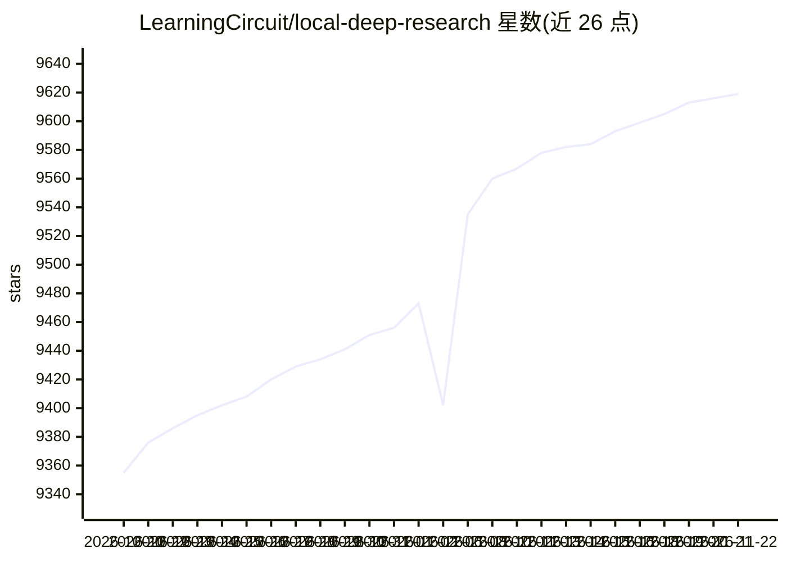

# LearningCircuit/local-deep-research

⭐ 9,619 · Python · MIT · 推送 2026-11-21 · [GitHub](https://github.com/LearningCircuit/local-deep-research) · 组织维护

**本地运行的 AI 深度研究助手，生成带引用的研究报告**

Local Deep Research 是一个可通过 Web 界面使用的 AI 研究助手：接收复杂问题后自动执行多轮检索与综合，跨网络、学术论文（arXiv、PubMed、Semantic Scholar）和用户自有文档生成带引用的报告。支持本地与云端 LLM（含 Ollama、llama.cpp、OpenAI 兼容端点），提供 LangGraph Agent 等研究策略，并可将检索到的来源下载进 AES-256 加密的个人知识库做索引与检索。提供 Docker、Docker Compose、pip 三种安装方式，跨 Windows/macOS/Linux，内置 egress 范围控制与每用户隔离数据库等安全机制。

## 筛选速览

| 维度 | 判定 | 备注 |
|---|---|---|
| AI 角色 | `ai-native` | 本体是模型或模型工具 |
| 许可风险 | `permissive` | MIT |
| 部署形态 | `self-host` | docker 或自建部署 |
| 模型依赖 | local-ok | 支持本地模型 |
| 硬件要求 | `cpu-ok` | |
| 安装摩擦 | `low` | 无编译、无系统依赖或容器化 |
| 成熟度 | `idea` | |

## 能力要点

- 基于 LangGraph 的 agentic 研究策略，自适应切换 10+ 搜索引擎
- 支持本地与云端 LLM（llama.cpp、Ollama、OpenAI 兼容端点）
- SQLCipher 加密的个人知识库：下载来源、索引、嵌入并可检索
- egress 范围控制（Adaptive/Public only/Private only/Strict）限制流量去向

## 适用场景

- 在本地硬件上运行研究助手以保护隐私
- 对学术文献与自己积累的文档做联合检索并生成引用报告
- 为家庭服务器搭建自主可控的深度研究工具

## 场景标签

`RAG` `科研工具` `文档问答` · 领域:知识与检索

## 证据(README 行号)

> L28: **AI-powered research assistant for deep, agentic research**
> L30: *Performs deep, agentic research using multiple LLMs and search engines with proper citations*
> L40: AI research assistant you control. Run locally for privacy, use any LLM and build your own searchable knowledge bas

## 星数曲线

2026-10-20 9,355 → 2026-11-22 9,619（+264）

---
*卡片 v1 · prompt 1.4 · 生成 2026-11-22 · 置信度 high · 依据 README sha `0081a611bb2e` · [字段定义](../../DATASET.md)*
