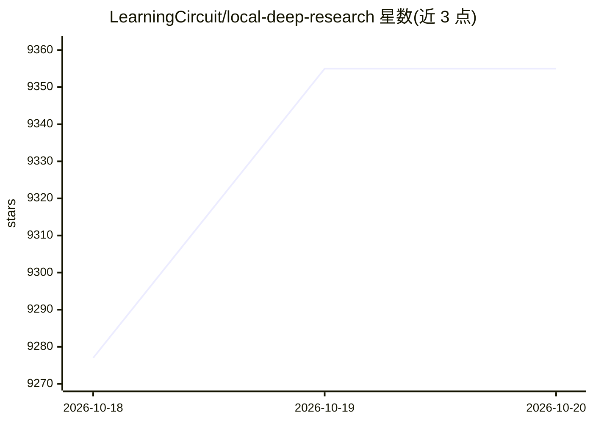

# LearningCircuit/local-deep-research

⭐ 9,355 · Python · MIT · 推送 2026-10-19 · [GitHub](https://github.com/LearningCircuit/local-deep-research) · 组织维护

**本地优先的深度研究助手：多搜索引擎+多LLM生成带引用报告**

面向需要隐私可控研究流程的用户的应用：输入复杂问题后，系统调用多个 LLM 与 10+ 搜索引擎（arXiv、PubMed、私有文档等）自动检索、综合并生成带引用的报告；提供 LangGraph 自主 agent 策略，在单张 RTX 3090 上报告约 95% SimpleQA。支持 Docker/pip 安装与本地/云端 LLM，内置 SQLCipher 每用户加密数据库、egress 出站范围控制等安全机制。附带加密个人图书馆：下载论文/网页、提取文本、索引并跨自有文档与实时网络检索。限制：需 AVX 指令集 CPU（2011 年后），本地中继到云端模型的场景无法被检测。

## 筛选速览

| 维度 | 判定 | 备注 |
|---|---|---|
| AI 角色 | `ai-native` | 本体是模型或模型工具 |
| 许可风险 | `permissive` | MIT |
| 部署形态 | `self-host` | docker 或自建部署 |
| 模型依赖 | local-ok | 支持本地模型 |
| 硬件要求 | `cpu-ok` | |
| 安装摩擦 | `low` | 无编译、无系统依赖或容器化 |
| 成熟度 | — | 结构信号不足 |

## 能力要点

- 多 LLM + 10+ 搜索引擎的 agentic 深度研究，输出带引用报告
- 本地单卡（RTX 3090 + Qwen3.6-27B）报告约 95% SimpleQA
- 每用户独立 SQLCipher AES-256 加密数据库与 egress 出站范围控制
- 加密知识库：下载来源、索引、跨自有文档检索

## 适用场景

- 在本地硬件上做隐私可控的文献与网络深度研究
- 把研究产出的论文和网页沉淀为可检索的私有知识库
- 限定只检索私有文档集合的合规研究流程

## 场景标签

`科研工具` `RAG` `知识库管理` · 领域:知识与检索

## 证据(README 行号)

> L28: **AI-powered research assistant for deep, agentic research**
> L88: You ask a complex question. Local Deep Research (LDR):
> L91: - Synthesizes everything into a report with proper citations

## 星数曲线

2026-10-18 9,277 → 2026-10-20 9,355（+78）

---
*卡片 v1 · prompt 1.4 · 生成 2026-10-20 · 置信度 high · 依据 README sha `38d6e32f6a23` · [字段定义](../../DATASET.md)*
