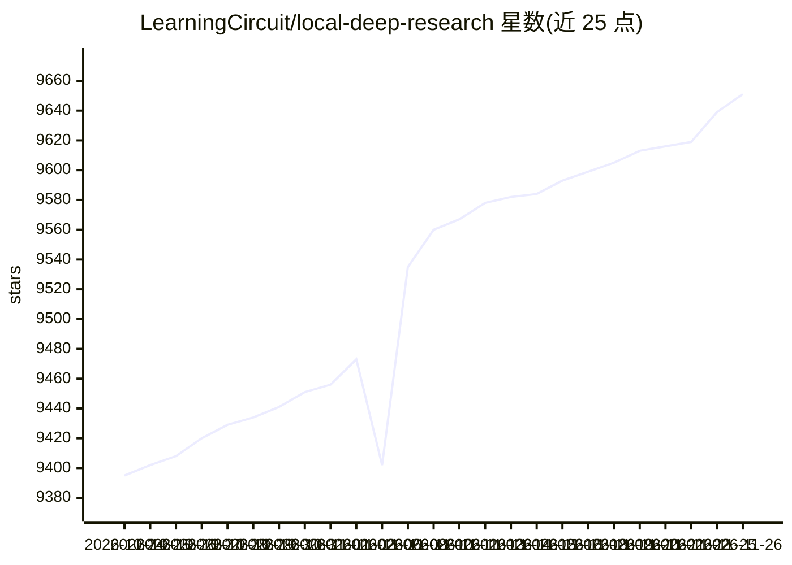

# LearningCircuit/local-deep-research

⭐ 9,651 · Python · MIT · 推送 2026-11-25 · [GitHub](https://github.com/LearningCircuit/local-deep-research) · 组织维护

**本地运行的 AI 深度研究助手，多源检索并生成带引用报告**

面向需要研究产出的用户，输入复杂问题后自动跨网络、学术引擎（arXiv/PubMed/Semantic Scholar）与本地文档检索，综合为带引用的研究报告；支持 LangGraph 自主 agent 策略，由 LLM 决定搜索与综合时机。每次研究会话的来源可下载到加密个人库，经索引/嵌入后可与实时网络一起查询。数据按用户隔离存储于 SQLCipher AES-256 加密库，提供 egress 范围控制（Public/Private/Strict 等模式）限制流量去向。通过 Docker、Docker Compose 或 pip 安装，Web UI 端口 5000。

## 筛选速览

| 维度 | 判定 | 备注 |
|---|---|---|
| AI 角色 | `ai-native` | 本体是模型或模型工具 |
| 许可风险 | `permissive` | MIT |
| 部署形态 | `self-host` | docker 或自建部署 |
| 模型依赖 | local-ok | 支持本地模型 |
| 硬件要求 | — | 无带数字的原话,不猜 |
| 安装摩擦 | `low` | 无编译、无系统依赖或容器化 |
| 成熟度 | `idea` | |

## 能力要点

- 自动跨网络、学术引擎与本地文档检索并生成带引用报告
- LangGraph agent 策略：LLM 自主决定搜索引擎与综合时机
- 研究来源可下载入加密个人库，构建可检索知识库
- egress 范围控制与每用户 SQLCipher AES-256 隔离加密库

## 适用场景

- 让我提出的复杂问题自动生成带引用的研究报告
- 把 arXiv/PubMed 论文存入本地加密库并跨文档提问
- 在断开云端的前提下仅用本地模型和本地文档做研究
- 在家用服务器上自托管一个私人研究助手

## 场景标签

`RAG` `科研工具` `文档问答` · 领域:知识与检索

## 证据(README 行号)

> L28: **AI-powered research assistant for deep, agentic research**
> L30: *Performs deep, agentic research using multiple LLMs and search engines with proper citations*
> L91: - Synthesizes everything into a report with proper citations

## 星数曲线

2026-10-24 9,395 → 2026-11-26 9,651（+256）

---
*卡片 v1 · prompt 1.4 · 生成 2026-11-26 · 置信度 high · 依据 README sha `8844d2bf97a7` · [字段定义](../../DATASET.md)*
