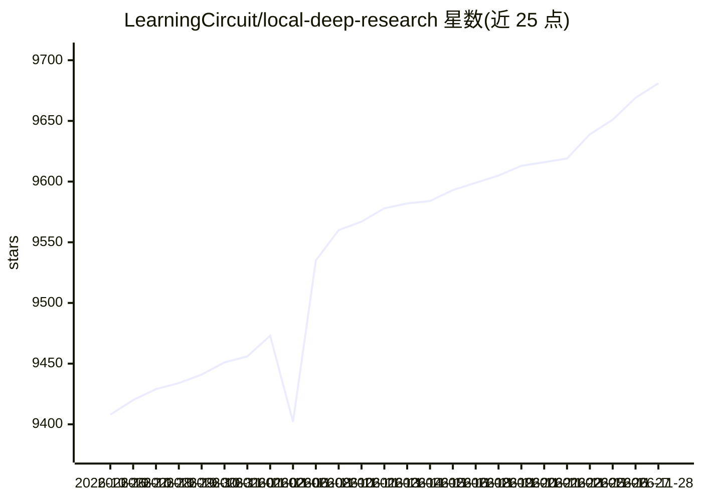

# LearningCircuit/local-deep-research

⭐ 9,681 · Python · MIT · 推送 2026-11-27 · [GitHub](https://github.com/LearningCircuit/local-deep-research) · 组织维护

**本地运行的 AI 深度研究助手，生成带引用的研究报告**

以 Web UI（默认 localhost:5000）运行的 AI 研究助手：接收复杂问题后自动跨网络、学术论文与用户自有文档检索，合成带引用的研究报告；提供 pipeline 快速模式与 LangGraph Agent 策略（LLM 决定搜索引擎与综合时机）。支持本地与云端 LLM 及 10+ 搜索引擎（arXiv、PubMed 等），研究来源可下载到 SQLCipher AES-256 加密的个人知识库并索引检索。安装提供 Docker Run、Docker Compose 与 pip 三种途径；需 Ollama 或 OpenAI 兼容端点与 SearXNG 配合；CPU 需支持 AVX。

## 筛选速览

| 维度 | 判定 | 备注 |
|---|---|---|
| AI 角色 | `ai-native` | 本体是模型或模型工具 |
| 许可风险 | `permissive` | MIT |
| 部署形态 | `self-host` | docker 或自建部署 |
| 模型依赖 | local-ok | 支持本地模型 |
| 硬件要求 | `cpu-ok` | |
| 安装摩擦 | `low` | 无编译、无系统依赖或容器化 |
| 成熟度 | — | 结构信号不足 |

## 能力要点

- LangGraph Agent 研究策略：LLM 自主选择搜索引擎并综合来源
- SQLCipher 每用户隔离加密数据库，密码不存储
- Egress 范围控制：Adaptive/Public only/Private only/Strict/Unprotected
- 支持本地与云端 LLM 及 arXiv、PubMed、私有文档等搜索源

## 适用场景

- 本地隐私环境下让 AI 自动完成带引用的深度研究
- 把检索到的论文和网页积累成可搜索的加密知识库
- 在自建服务器/家庭服务器上部署研究助手服务

## 场景标签

`科研工具` `知识库管理` · 领域:知识与检索

## 证据(README 行号)

> L28: **AI-powered research assistant for deep, agentic research**
> L40: AI research assistant you control. Run locally for privacy, use any LLM and build your own searchable knowledge bas
> L88: You ask a complex question. Local Deep Research (LDR):
> L91: - Synthesizes everything into a report with proper citations

## 星数曲线

2026-10-26 9,408 → 2026-11-28 9,681（+273）

---
*卡片 v1 · prompt 1.4 · 生成 2026-11-28 · 置信度 high · 依据 README sha `61ec3fb4c578` · [字段定义](../../DATASET.md)*
