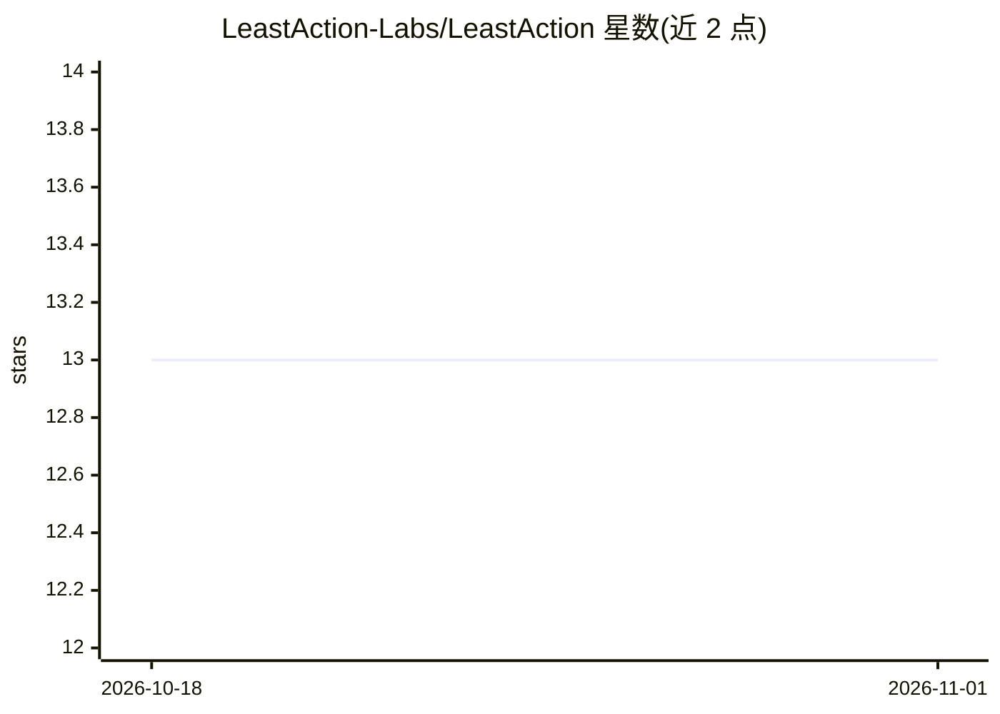

# LeastAction-Labs/LeastAction

⭐ 13 · Python · NOASSERTION · 推送 2026-10-12 · [GitHub](https://github.com/LeastAction-Labs/LeastAction) · [官网](https://leastactionlabs.com) · 组织维护

**自托管数据工作流平台：AI 操作员生成、运行并修复管道**

面向团队的自托管数据工作流平台，核心是目录（catalog）+ AI 操作员：以 Connection+Operator+Payload+Config 组合定义任务，AI 可生成操作符、部署、运行、读日志、查询结果数据库、发现数据问题、修复并重跑，形成无人介入的闭环；通过 MCP 工具（如 inspect_data）连接 PostgreSQL、Athena、Redshift、BigQuery、S3 等已有技术栈，无需迁移。工程师用 Python 写操作符，其他成员从 UI 或 Git 组装调度管道。提供 Docker Compose 与 Blue-Green 两种部署路径，附 Marketplace 与报告浏览（Experimental Preview）。核心采用 Sustainable Use License，可免费自托管内部使用。

## 筛选速览

| 维度 | 判定 | 备注 |
|---|---|---|
| AI 角色 | `ai-enhanced` | 去掉 AI 部分产品仍成立 |
| 许可风险 | `none` | NOASSERTION |
| 部署形态 | `self-host` | docker 或自建部署 |
| 模型依赖 | — | README 未给出锁定关系 |
| 硬件要求 | — | 无带数字的原话,不猜 |
| 安装摩擦 | `low` | 无编译、无系统依赖或容器化 |
| 成熟度 | — | 结构信号不足 |

## 能力要点

- AI 操作员端到端闭环：生成代码→部署→运行→读日志→查询→修复→重跑
- 任务模型：Connection+Operator+Payload+Config，支持分区并行与按名跨项目依赖
- MCP 工具直连目录连接（PostgreSQL/Athena/Redshift/BigQuery/S3 等）供 AI 自校验
- Docker Compose 开发部署与 Blue-Green 零停机生产部署脚本

## 适用场景

- 团队在现有 PostgreSQL/BigQuery/Airflow 等技术栈上编排数据管道，无需迁移
- 让 AI 在会话内完成管道生成、运行、验证与修复的全流程
- 业务用户通过报告浏览页面向 AI 提问、刷新报告并触发任务

## 场景标签

`工作流自动化` · 领域:效率与自动化

## 证据(README 行号)

> L3: Most AI tools help you write pipeline code. LeastAction gives the AI an operator — it generates the code, deploys it
> L11: - **The AI operates, end to end.** It generates the operator, deploys it, runs it, reads logs, queries the result, 
> L12: - **Orchestrate without Python.** Engineers write operators in Python (or generate them with AI); everyone else ass

## 星数曲线

2026-10-18 13 → 2026-11-01 13（+0）

---
*卡片 v1 · prompt 1.4 · 生成 2026-10-31 · 置信度 high · 依据 README sha `1ef1a6d070b4` · [字段定义](../../DATASET.md)*
