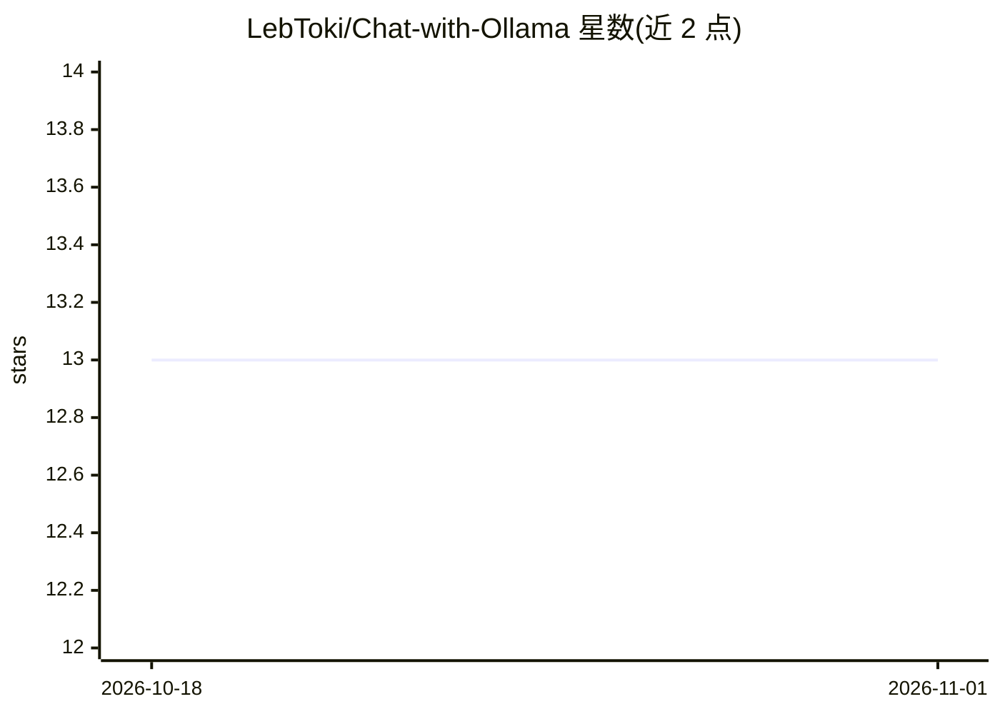

# LebToki/Chat-with-Ollama

⭐ 13 · PHP · 推送 2026-03-28 · [GitHub](https://github.com/LebToki/Chat-with-Ollama) · 组织维护

**对接 Ollama 本地模型的 PHP RAG 聊天应用，可上传文档问答**

基于 PHP 8.1+ 与 SQLite 的自托管 Web 聊天应用：通过 Ollama API 与本地安装的任意模型对话，支持上传 PDF/DOCX/TXT/MD/PPT(X)/XLSX/CSV 文档，自动分块（1000 字符、200 重叠）、用 nomic-embed-text 生成向量存入 SQLite，检索时以余弦相似度取前 5 块作为上下文。提供会话管理、@ 引用特定文档、文档专属会话、全文搜索与设置页。需配合本地或远程运行的 Ollama，通过 git clone 与 Composer 安装，配置 Apache/Nginx。README 同时推介同团队的商业版 NexusAI Chat。

## 筛选速览

| 维度 | 判定 | 备注 |
|---|---|---|
| AI 角色 | `ai-native` | 本体是模型或模型工具 |
| 许可风险 | `none` | — |
| 部署形态 | `None` |  |
| 模型依赖 | local-ok | 支持本地模型 |
| 硬件要求 | — | 无带数字的原话,不猜 |
| 安装摩擦 | `low` | 无编译、无系统依赖或容器化 |
| 成熟度 | — | 结构信号不足 |

## 能力要点

- 对接 Ollama 本地推理，可选服务端已安装的任意模型
- 文档上传后自动分块、nomic-embed-text 嵌入并存入 SQLite 的 RAG 流程
- 按消息粒度开关 RAG，@ 提及与文档专属会话限定检索范围
- MIT 许可的自托管 PHP 应用，附带 Chat/会话/RAG/模型 REST API

## 适用场景

- 在自己服务器上搭建不依赖外部 API 的私有 AI 聊天
- 让模型基于我自己上传的文档回答问题
- 把不同项目的文档分开成独立会话做针对性问答

## 场景标签

`文档问答` `聊天机器人` · 领域:对话与助手

## 证据(README 行号)

> L3: A modern, RAG-powered AI chat application that integrates with Ollama for local AI inference. Chat with various Olla
> L197: 1. **Document Upload**: Upload your document (PDF, DOCX, etc.)
> L200: 4. **Embedding**: Each chunk is converted to vector embeddings using `nomic-embed-text`

## 星数曲线

2026-10-18 13 → 2026-11-01 13（+0）

---
*卡片 v1 · prompt 1.4 · 生成 2026-10-31 · 置信度 high · 依据 README sha `3e87fce33531` · [字段定义](../../DATASET.md)*
