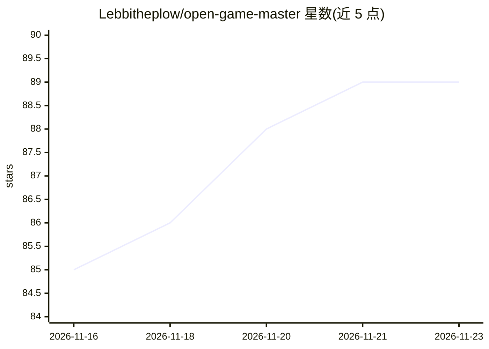

# Lebbitheplow/open-game-master

⭐ 89 · TypeScript · MIT · 推送 2026-11-22 · [GitHub](https://github.com/Lebbitheplow/open-game-master) · [官网](https://opengamemaster.com) · 个人维护

**本地/自选模型驱动的 AI 游戏主持人：多人跑 5e 战役**

多人（含单人）5e 战役运行应用：AI 作为游戏主持人负责叙事、NPC 与同伴扮演、推进秘密剧情线，玩家可选本地模型（llama.cpp/Ollama/LM Studio/vLLM）、API key（OpenAI/OpenRouter/任意 OpenAI 兼容端点）或已有订阅的 CLI agent（Codex/Grok Build/Claude Code/opencode/Pi）作为叙述者。骰子、生命值、法术位等数值由服务端引擎计算并钳制，模型只能经服务端校验的工具修改游戏状态。本地模型需至少 16 GB 显存；提供 Node 22+ 源码运行与 Docker 两种部署，状态存于本地加密 SQLite。

## 筛选速览

| 维度 | 判定 | 备注 |
|---|---|---|
| AI 角色 | `ai-native` | 本体是模型或模型工具 |
| 许可风险 | `permissive` | MIT |
| 部署形态 | `self-host` | docker 或自建部署 |
| 模型依赖 | local-ok | 支持本地模型 |
| 硬件要求 | — | 无带数字的原话,不猜 |
| 安装摩擦 | `low` | 无编译、无系统依赖或容器化 |
| 成熟度 | — | 结构信号不足 |

## 能力要点

- 叙述者可换：本地模型 / API key / CLI agent 订阅三种接入方式
- 规则由服务端引擎强制执行，模型不拥有任何数值
- 秘密故事弧、战争迷雾地图、48 职业 SRD 5.1 结构化角色卡
- 本地加密 SQLite 存储、无人云端账号、无遥测

## 适用场景

- 和朋友们联机跑由 AI 主持的 5e 战役，或独自单人游玩
- 用自己的本地模型当 GM，全程数据不出本机
- 真人 GM 模式下用应用管理卡表、骰子与地图，可把部分环节委托给 AI

## 场景标签

 · 领域:游戏/桌面角色扮演

## 证据(README 行号)

> L22: **Open Game Master** runs multiplayer (and solo) 5e
> L24: AI you already have: **a local model** (llama.cpp, Ollama, LM Studio, vLLM), **an
> L69:  A local model (llama.cpp, Ollama, LM Studio, vLLM; gpt-oss-20b on a 16 GB gaming card), an API key (OpenAI, OpenRo

## 星数曲线

2026-11-16 85 → 2026-11-23 89（+4）

---
*卡片 v1 · prompt 1.4 · 生成 2026-11-18 · 置信度 high · 依据 README sha `ff5b1e84e0b6` · [字段定义](../../DATASET.md)*
