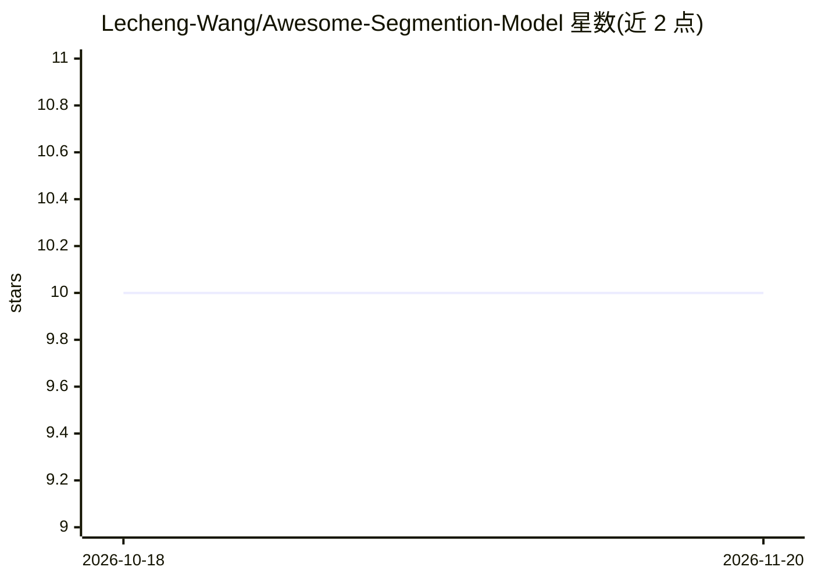

# Lecheng-Wang/Awesome-Segmention-Model

⭐ 10 · Python · 推送 2026-01-28 · [GitHub](https://github.com/Lecheng-Wang/Awesome-Segmention-Model) · 个人维护 · 中文 README

**面向分割任务研究者的14种语义分割模型统一训练框架**

基于 PyTorch 的语义分割统一训练框架，通过 --MODEL_TYPE 参数在 U-Net、DeepLab、SegFormer、Mask2Former 等 14 种架构间切换，并内置近 20 种可替换骨干网络。训练流程覆盖数据加载、迭代、验证评估、权重保存与 CSV 日志记录，支持单卡/多卡训练、CE/Focal 损失、四种学习率调度与类别权重加权，面向遥感、医学影像等分割任务与模型对比实验。需自行准备数据列表文件；Mask2Former 存在代码问题，作者标注不建议使用。

## 筛选速览

| 维度 | 判定 | 备注 |
|---|---|---|
| AI 角色 | `ai-native` | 本体是模型或模型工具 |
| 许可风险 | `none` | — |
| 部署形态 | `library` | 以包/库形式分发 |
| 模型依赖 | — | README 未给出锁定关系 |
| 硬件要求 | — | 无带数字的原话,不猜 |
| 安装摩擦 | `low` | 无编译、无系统依赖或容器化 |
| 成熟度 | — | 结构信号不足 |

## 能力要点

- 14 种分割架构通过命令行参数切换，含 CNN 与 Transformer 系列
- 默认支持 10 通道多波段输入，适配遥感/多光谱影像
- 输出 mIoU、Kappa、F1 等全维度指标及逐类别细分，写入 CSV 日志
- 内置近 20 种骨干网络可替换，自动处理多卡权重与单卡部署格式适配

## 适用场景

- 训练遥感影像或多光谱图像的语义分割模型
- 医学影像、道路场景等像素级分割任务训练
- 不同分割架构与骨干网络的性能对比实验
- 改进算法的验证与训练复现

## 场景标签

 · 领域:计算机视觉/深度学习

## 证据(README 行号)

> L3: 该代码是一套功能完备、高灵活性、一站式的多模型语义分割统一训练框架，不仅全面整合了 U-Net、DeepLab、ENet、FCN、HRNet、SegNet、RefineNet、PSPNet、SegFormer、SETR、UperNe
> L7: 整个框架实现了从模型实例化、数据集加载、训练迭代、梯度反向传播，到验证集性能评估、模型权重自动保存、训练日志完整记录的端到端全流程闭环，无需额外补充辅助代码。在数据处理层面，基于 PyTorch 的Dataset抽象类与DataLo

## 星数曲线

2026-10-18 10 → 2026-11-20 10（+0）

---
*卡片 v1 · prompt 1.4 · 生成 2026-11-20 · 置信度 mid · 依据 README sha `4147047d23db` · [字段定义](../../DATASET.md)*
