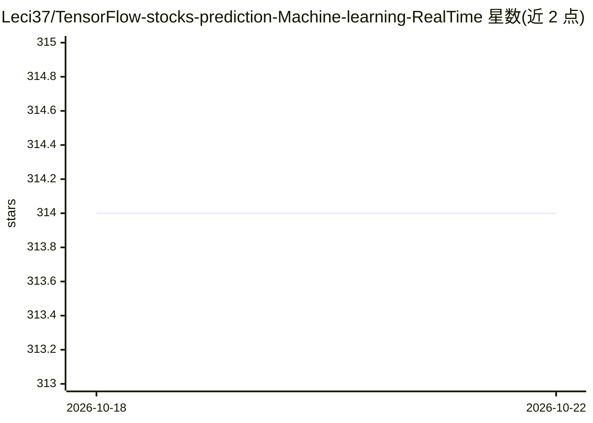

# Leci37/TensorFlow-stocks-prediction-Machine-learning-RealTime

⭐ 314 · Python · 推送 2026-10-05 · [GitHub](https://github.com/Leci37/TensorFlow-stocks-prediction-Machine-learning-RealTime) · 个人维护

**用 TensorFlow/Sklearn/XGBoost 从技术指标预测股票买卖点的框架**

面向量化交易开发者的股票买卖点预测项目：读取 OLHCV 历史数据，计算 637 个技术指标，生成 buy/sell/do-nothing 分类目标，支持 36 种模型组合训练（TensorFlow LSTM/GRU、RandomForest、GradientBoosting、XGBoost 等），并做模型评估。实时预测部分通过 Telegram 通知，实时驱动文件需向作者索取。强调需先运行教程脚本理解流程，且作者自述预测模型仍需改进。运行时间按 Intel i3/8GB RAM 估算，教程基于 Python 3.8。

## 筛选速览

| 维度 | 判定 | 备注 |
|---|---|---|
| AI 角色 | `ai-native` | 本体是模型或模型工具 |
| 许可风险 | `none` | — |
| 部署形态 | `library` | 以包/库形式分发 |
| 模型依赖 | — | README 未给出锁定关系 |
| 硬件要求 | — | 无带数字的原话,不猜 |
| 安装摩擦 | `low` | 无编译、无系统依赖或容器化 |
| 成熟度 | `idea` | |

## 能力要点

- 测试 36 种模型组合（TensorFlow、XGBoost、Sklearn、LSTM、GRU 等）
- 使用 637 个股票技术指标并自动筛选有效模式
- 分类目标输出（do buy/do sell/do nothing）
- 实时预测结果可经 Telegram/Mail 通知

## 适用场景

- 训练自己的股票买卖点预测模型
- 用最新行情数据做实时预测并接收 Telegram 提醒
- 学习从数据读取到模型训练评估的完整量化流程

## 场景标签

`金融量化` `教程课程` · 领域:学习与行业

## 证据(README 行号)

> L12: + Testing with _**36 models**_. Multiple combinations features and multiple selections of models, easily expandable
> L16: + Response _**categorical target**_ (do buy, do sell and do nothing) simple and dynamic, instead of poor and confus

## 星数曲线

2026-10-18 314 → 2026-10-22 314（+0）

---
*卡片 v1 · prompt 1.4 · 生成 2026-10-21 · 置信度 mid · 依据 README sha `107414e73548` · [字段定义](../../DATASET.md)*
