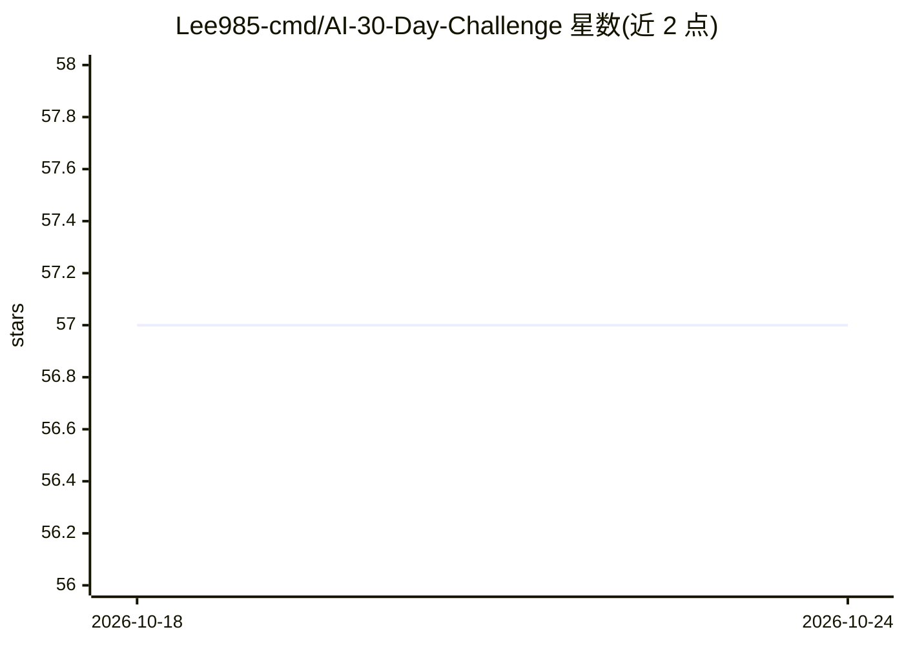

# Lee985-cmd/AI-30-Day-Challenge

⭐ 57 · Python · MIT · 推送 2026-09-15 · [GitHub](https://github.com/Lee985-cmd/AI-30-Day-Challenge) · 个人维护 · 中文 README

**面向零基础学习者的 30 天 AI 入门教程与可运行项目合集**

以费曼学习法编写的 AI 入门学习仓库：提供 30 天系统教程（150,000+ 字）、200+ 代码示例和 12 个完整可运行项目，路径从 Python/机器学习基础到 CV/NLP 实战、Agent 应用（RAG、智能客服、多 Agent 协作、AutoGPT 演示）与 FastAPI/Docker 模型部署。依赖 Python 3.7+ 与 PyTorch，通过 git clone 加虚拟环境运行，配有 CSDN 专栏作为配套理论教程。README 明确标注不适合已有多年 AI 经验的开发者。文末附有多条相互矛盾的维护状态记录。

## 筛选速览

| 维度 | 判定 | 备注 |
|---|---|---|
| AI 角色 | `ai-knowledge` | 知识聚合/清单类 |
| 许可风险 | `permissive` | MIT |
| 部署形态 | `None` |  |
| 模型依赖 | — | README 未给出锁定关系 |
| 硬件要求 | — | 无带数字的原话,不猜 |
| 安装摩擦 | `low` | 无编译、无系统依赖或容器化 |
| 成熟度 | — | 结构信号不足 |

## 能力要点

- 30 天教程覆盖 Python→ML→DL→CV/NLP→Agent→部署完整路径
- 12 个可运行项目含 RAG 知识库、AI 客服、多 Agent 投研、AutoGPT 演示
- 200+ 代码示例，git clone 后按项目目录直接运行
- MIT 许可，配套 CSDN 专栏持续更新

## 适用场景

- 零基础或转行学习者按 30 天计划系统入门 AI
- 在校学生跑完整项目充实简历
- 按求职方向（CV/大模型应用）选择对应项目路线练习

## 场景标签

`教程课程` · 领域:学习与行业

## 证据(README 行号)

> L3: > 🤖 **30 天 AI 零基础到实战** | 📚 费曼学习法教程 | 12 个完整项目可运行
> L45: ### 📚 30 天系统教程
> L151: ├── tutorials/               # 30 天教程（费曼学习法解答集）

## 星数曲线

2026-10-18 57 → 2026-10-24 57（+0）

---
*卡片 v1 · prompt 1.4 · 生成 2026-10-24 · 置信度 low · 依据 README sha `d8236bbbf9c7` · [字段定义](../../DATASET.md)*
