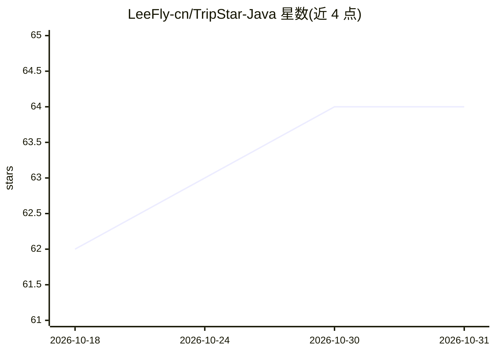

# LeeFly-cn/TripStar-Java

⭐ 64 · JavaScript · GPL-2.0 · 推送 2026-07-20 · [GitHub](https://github.com/LeeFly-cn/TripStar-Java) · 个人维护 · 中文 README

**面向旅行者的多智能体旅行攻略生成系统（Java 后端）**

基于 Spring Boot 4 与 Spring AI Alibaba 的前后端分离 AI 旅行规划项目。多 Agent 协作（StateGraph 控制流程、ReactAgent 做工具调用）读取小红书旅行笔记，用多模态模型识别图片中的路线与酒店信息，结合高德 POI、天气、酒店、餐饮数据生成含每日路线、地图、预算和知识图谱的攻略。支持自主规划与指定笔记规划两种模式，未配置密钥或调用失败时明确报错，不返回模拟数据。运行需 JDK 21、Node.js 18+、MySQL、Redis、DashScope 与高德 Key，自主规划需小红书 Cookie。GPL-2.0 开源。

## 筛选速览

| 维度 | 判定 | 备注 |
|---|---|---|
| AI 角色 | `ai-native` | 本体是模型或模型工具 |
| 许可风险 | `viral` | GPL-2.0 |
| 部署形态 | `library` | 以包/库形式分发 |
| 模型依赖 | — | README 未给出锁定关系 |
| 硬件要求 | — | 无带数字的原话,不猜 |
| 安装摩擦 | `medium` | 含编译或系统依赖之一 |
| 成熟度 | — | 结构信号不足 |

## 能力要点

- 自主规划七阶段 Agent 流水线：小红书搜索→详情→高德 POI→天气→酒店餐饮→Planner→Review
- 指定笔记规划用多模态模型识别图片中的 Day/路线/酒店/餐厅信息
- AI Trace 文件记录提示词、工具列表与模型原始输出，便于排查
- WebSocket 实时推送阶段进度与错误信息

## 适用场景

- 输入目的地和偏好自动生成带预算的每日行程攻略
- 粘贴小红书攻略链接或正文，复刻并补全笔记行程
- 通过对话接口基于当前行程继续问答

## 场景标签

`多智能体` · 领域:Agent 开发

## 证据(README 行号)

> L10: TripStar 是一个前后端分离的 AI 旅行规划项目。系统使用多 Agent 协作理解用户需求，读取小红书旅行内容，查询高德 POI、天气、酒店与餐饮，并生成包含每日路线、地图、景点图片、预算和知识图谱的完整攻略。
> L56: 6. Planner Agent 生成每日行程和预算。

## 星数曲线

2026-10-18 62 → 2026-10-31 64（+2）

---
*卡片 v1 · prompt 1.4 · 生成 2026-10-24 · 置信度 mid · 依据 README sha `3c543fa34e3e` · [字段定义](../../DATASET.md)*
