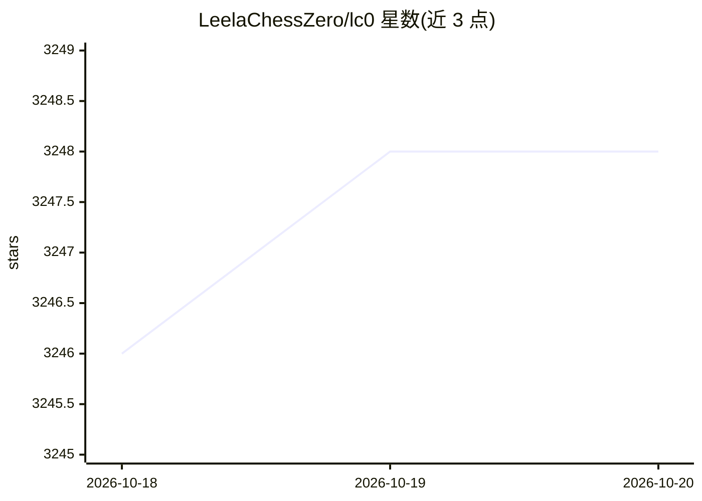

# LeelaChessZero/lc0

⭐ 3,248 · C++ · GPL-3.0 · 推送 2026-10-19 · [GitHub](https://github.com/LeelaChessZero/lc0) · [官网](https://lczero.org/) · 组织维护

**神经网络国际象棋引擎，UCI 协议，多 GPU 后端加速**

Lc0 是符合 UCI 协议的开源国际象棋引擎，使用 LeelaChessZero 项目的神经网络下棋，支持自对弈棋局生成与对局。构建需要 Meson 构建系统、C++20 编译器和至少一个神经网络后端库：CPU 侧支持 OpenBLAS/DNNL 等 CBLAS 兼容库，GPU 侧支持 CUDA(可配 cuDNN)、AMD HIP/ROCm、onnxruntime 多种执行提供方、Apple Metal 及实验性 SYCL。通过 build.sh/build.cmd 从源码构建，v0.32.0 起 Mac 提供预编译版本，另可安装 Python 绑定包 lczero-bindings 做局面评估。GPLv3 并附带 section 7 附加许可。

## 筛选速览

| 维度 | 判定 | 备注 |
|---|---|---|
| AI 角色 | `ai-native` | 本体是模型或模型工具 |
| 许可风险 | `viral` | GPL-3.0 |
| 部署形态 | `desktop` | 安装包/桌面程序 |
| 模型依赖 | — | README 未给出锁定关系 |
| 硬件要求 | — | 无带数字的原话,不猜 |
| 安装摩擦 | `high` | 编译与系统依赖俱全 |
| 成熟度 | `idea` | |

## 能力要点

- UCI 协议兼容，通过神经网络进行走子决策
- 多后端支持：CUDA/cuDNN、HIP/ROCm、onnxruntime（含 onnx-trt/onnx-dml）、Metal、SYCL、BLAS
- HIP 后端复用自有 CUDA 内核，在 gfx90a 与 gfx1100 上验证
- pip 安装 lczero-bindings Python 绑定，暴露局面评估功能

## 适用场景

- 接入 UCI 图形界面进行对局或分析
- 为 LeelaChessZero 项目生成自对弈训练棋局
- 通过 Python 绑定做国际象棋局面评估

## 场景标签

 · 领域:游戏 AI/棋类引擎

## 证据(README 行号)

> L6: Lc0 is a UCI-compliant chess engine designed to play chess via neural network, specifically those of the LeelaChessZ
> L41: Backend support includes (in theory) any CBLAS-compatible library for CPU usage, but OpenBLAS or Intel's DNNL are t

## 星数曲线

2026-10-18 3,246 → 2026-10-20 3,248（+2）

---
*卡片 v1 · prompt 1.4 · 生成 2026-10-20 · 置信度 mid · 依据 README sha `d910a00d6776` · [字段定义](../../DATASET.md)*
