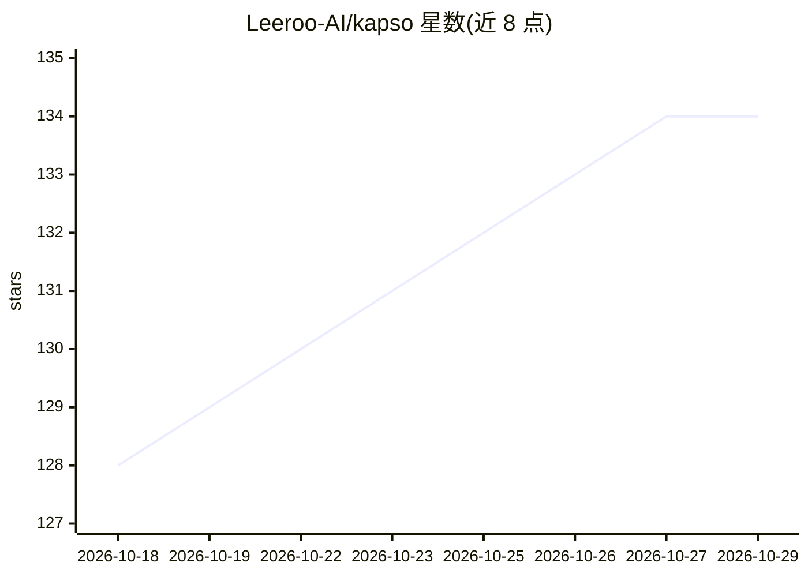

# Leeroo-AI/kapso

⭐ 134 · Python · MIT · 推送 2026-10-28 · [GitHub](https://github.com/Leeroo-AI/kapso) · [官网](https://docs.leeroo.com/docs) · 组织维护

**面向 AI/数据系统优化的长时运行 agent 框架**

Leeroo 开源的 Python 框架（PyPI 包 leeroo-kapso）：用户给出目标后，一组长时运行 agent 运行 campaign——用树搜索设计候选方案、由编码 agent 实现、度量与目标的差距并持续迭代，结果可部署到本地、Docker 或 Modal。四大支柱为 evolve/learn/research/deploy：从已完成 campaign 挖掘带证据的知识卡，把外部仓库与论文导入 Weaviate+Neo4j 知识图谱。推理经编码 agent CLI（Claude Code、Codex）执行，无直接 API 回退；需 Node.js 18+ 与两个 CLI 登录。支持 MLE-Bench、ALE-Bench、RelBench 基准。

## 筛选速览

| 维度 | 判定 | 备注 |
|---|---|---|
| AI 角色 | `ai-ecosystem` | LLM/agent 周边工具 |
| 许可风险 | `permissive` | MIT |
| 部署形态 | `library` | 以包/库形式分发 |
| 模型依赖 | locked-api |  |
| 硬件要求 | — | 无带数字的原话,不猜 |
| 安装摩擦 | `medium` | 含编译或系统依赖之一 |
| 成熟度 | — | 结构信号不足 |

## 能力要点

- evolve/learn/research/deploy 四动词 API 组成核心循环
- 经验挖掘为证据计价知识卡，外部知识入 Weaviate+Neo4j 知识图谱
- 推理经 Claude Code/Codex CLI 执行，模型可在单一配置文件中指定
- kapso doctor 预检依赖与模型可用性

## 适用场景

- 自动迭代优化 CUDA/PyTorch 代码与 ML 建模流程
- 让 agent 团队端到端交付可部署的预测模型
- 把历史实验与外部资料沉淀为知识库供后续 campaign 复用

## 场景标签

`Agent 框架` `编码 Agent` · 领域:Agent 开发

## 证据(README 行号)

> L50: Kapso is a team of long-running agents that optimize AI and Data systems. State an objective and it runs a campaign
> L54: Kapso is an open-source Python framework by Leeroo, published on PyPI as `leeroo-kapso`.
> L60: |**Evolve**|`.evolve()`|Run iterative experiments to build software for a goal. Uses tree search, coding agents, an

## 星数曲线

2026-10-18 128 → 2026-10-29 134（+6）

---
*卡片 v1 · prompt 1.4 · 生成 2026-10-23 · 置信度 mid · 依据 README sha `a78dde5d7453` · [字段定义](../../DATASET.md)*
