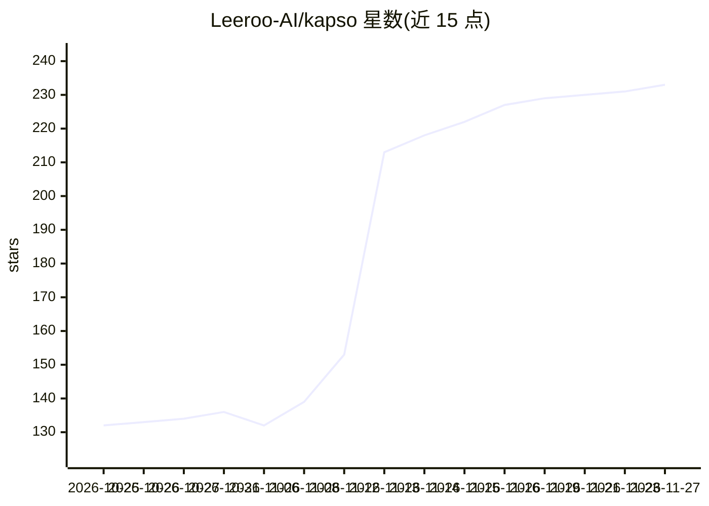

# Leeroo-AI/kapso

⭐ — · [GitHub]() · 组织维护

**面向 ML 开发者的自主实验引擎：跑实验、部署最优解、沉淀经验**

以领域 harness 和经验库为起点，给定目标与成功标准后自动运行实验树：提出假设、在分支上实现并验证、将最优解部署到目标栈；每次运行的结果以带 credence 分数和适用边界的 lesson 形式存入基于 git 的经验库，并通过 A/B 重建衡量改动收益。推理经由 Claude Code/Codex 等 coding-agent CLI 完成（无直接 API 回退），支持 budget 上限、经验库索引（Weaviate/Neo4j，可选）与多目标部署（Docker/Modal/BentoCloud/LangGraph）。

## 筛选速览

| 维度 | 判定 | 备注 |
|---|---|---|
| AI 角色 | `ai-ecosystem` | LLM/agent 周边工具 |
| 许可风险 | `permissive` | — |
| 部署形态 | `library` | 以包/库形式分发 |
| 模型依赖 | — | README 未给出锁定关系 |
| 硬件要求 | — | 无带数字的原话,不猜 |
| 安装摩擦 | `medium` | 含编译或系统依赖之一 |
| 成熟度 | — | 结构信号不足 |

## 能力要点

- 实验树搜索：假设生成、分支实现、指纹化 evaluator 验证
- 经验库 lesson 带 credence 分数与适用边界，learn() 对每次改动做 A/B 验证
- 部署支持 Docker、Modal、BentoCloud、LangGraph Platform，含健康检查与可用性证明
- 模型无关与 coding-agent 无关，模型配置集中在单一 config 文件

## 适用场景

- 自动跑通 Kaggle 类 ML 竞赛并产出可提交方案
- 对关系数据做预测建模并部署最优模型
- 为特定领域编写 harness 积累可复用实验经验

## 场景标签

`编码 Agent` · 领域:编码与开发

## 证据(README 行号)

> L50: Kapso is an open-source engine that runs experiments, deploys the best solution, and learns from every run. It star
> L56: Over time the domain harness carries a bank of lessons: the experimented best practices of that environment. Kapso 
> L87: **1. Prerequisites.** Kapso runs its inference through coding-agent CLIs

## 星数曲线

2026-10-25 132 → 2026-11-27 233（+101）

---
*卡片 v1 · prompt 1.4 · 生成 2026-11-25 · 置信度 mid · 依据 README sha `d4035c962e3a` · [字段定义](../../DATASET.md)*
