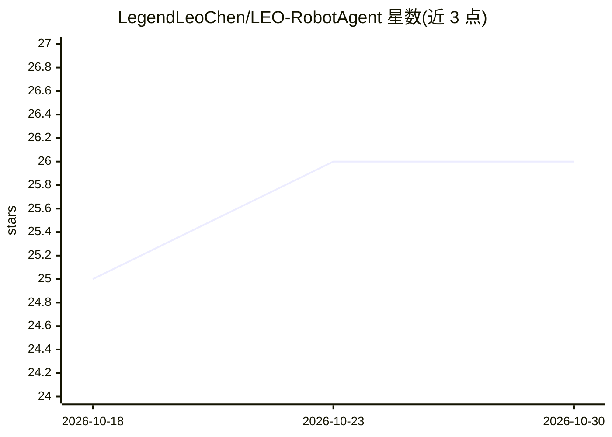

# LegendLeoChen/LEO-RobotAgent

⭐ 26 · Python · Apache-2.0 · 推送 2025-12-14 · [GitHub](https://github.com/LegendLeoChen/LEO-RobotAgent) · 个人维护 · 中文 README

**面向研究者的 LLM 机器人智能体框架：语言驱动多种机器人**

基于 LLM 的通用机器人智能体框架：大模型在框架内推理、规划并调用工具，控制无人机、带机械臂的轮式机器人、宇树机械狗三类已适配平台完成语言描述的任务。提供模块化、可注册的工具集合与 ROS+Web 应用系统：Web 界面可配置工具、对话下发任务、监控话题与摄像头。视觉节点提供 VLM 与 YOLOv8l-worldv2 目标检测。开发环境为 Ubuntu 20.04 + ROS Noetic，使用 Qwen3 系列（含 Qwen-VL），仅对该系列保证兼容。有 arXiv 论文（2512.10605）。

## 筛选速览

| 维度 | 判定 | 备注 |
|---|---|---|
| AI 角色 | `ai-ecosystem` | LLM/agent 周边工具 |
| 许可风险 | `permissive` | Apache-2.0 |
| 部署形态 | `desktop` | 安装包/桌面程序 |
| 模型依赖 | — | README 未给出锁定关系 |
| 硬件要求 | — | 无带数字的原话,不猜 |
| 安装摩擦 | `low` | 无编译、无系统依赖或容器化 |
| 成熟度 | — | 结构信号不足 |

## 能力要点

- LLM 自主思考-规划-行动循环驱动多类型机器人
- 模块化可注册工具集合，带新工具开发示例
- ROS+Web 应用系统：工具配置、对话交互、话题/摄像头监控
- 视觉节点提供 VLM 与 yolov8l-worldv2 目标检测

## 适用场景

- 用自然语言给无人机/轮式机器人/机械狗下达任务并自动执行
- 在仿真（Gazebo/PX4）或实机上进行具身智能实验
- 在任务执行中打断、修正或指出错误，人机协作

## 场景标签

`Agent 框架` · 领域:Agent 开发

## 证据(README 行号)

> L10: LEO-RobotAgent is a general-purpose robotic intelligent agent framework based on Large Language Models (LLMs). Unde
> L14: The LLM-based general-purpose robotic agent framework, LEO-RobotAgent, is shown in the figure above. The large mode

## 星数曲线

2026-10-18 25 → 2026-10-30 26（+1）

---
*卡片 v1 · prompt 1.4 · 生成 2026-10-26 · 置信度 mid · 依据 README sha `429986bdacb6` · [字段定义](../../DATASET.md)*
