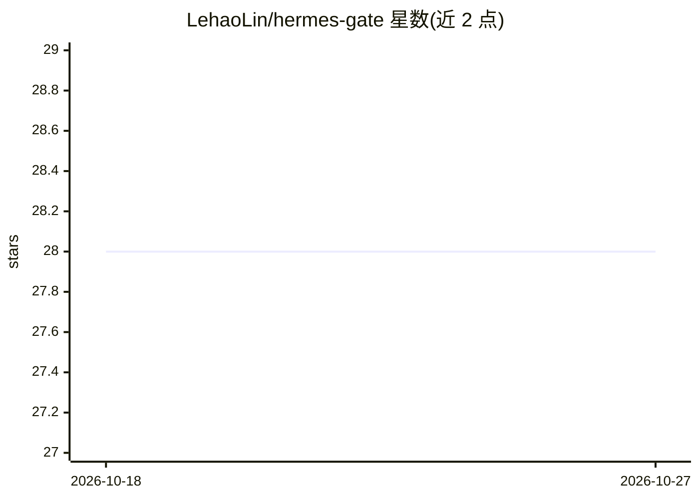

# LehaoLin/hermes-gate

⭐ 28 · Python · MIT · 推送 2026-04-21 · [GitHub](https://github.com/LehaoLin/hermes-gate) · 个人维护 · 中文 README

**远程管理云服务器上 Hermes Agent 会话的终端 TUI 客户端**

基于 Textual 的终端 TUI，运行在本地 Docker 容器中，通过 SSH 远程管理云服务器上 Hermes Agent（NousResearch 开源 AI agent 框架）的 tmux 会话：浏览服务器、创建/销毁会话、实时查看 Agent 输出并发送提示词，带 TCP 延迟监控、SSH config 别名支持与跨平台桌面通知/声音提醒。退出 TUI 时本地容器停止，远程会话不受影响。需 Docker 与 SSH 密钥，一条 run.sh 命令启动。

## 筛选速览

| 维度 | 判定 | 备注 |
|---|---|---|
| AI 角色 | `ai-ecosystem` | LLM/agent 周边工具 |
| 许可风险 | `permissive` | MIT |
| 部署形态 | `self-host` | docker 或自建部署 |
| 模型依赖 | — | README 未给出锁定关系 |
| 硬件要求 | — | 无带数字的原话,不猜 |
| 安装摩擦 | `low` | 无编译、无系统依赖或容器化 |
| 成熟度 | — | 结构信号不足 |

## 能力要点

- 在单一 Docker 容器中以 TUI 管理多服务器、多会话的远程 Hermes Agent
- 远程 tmux 会话持久化：退出客户端后服务器进程继续运行
- Agent 任务完成时跨平台桌面通知与声音提醒（gate-notify 插件）
- ./run.sh 一条命令构建、启动并进入 TUI

## 适用场景

- 我在云服务器上跑 Hermes Agent，想用 TUI 远程查看和发送提示词
- 网络不稳时确认远程 Agent 会话是否仍在运行并快速重连
- 同时管理多台服务器上的多个 Agent 会话，任务完成时收到通知

## 场景标签

 · 领域:开发运维工具/AI agent 管理

## 证据(README 行号)

> L5: A feature-rich **terminal TUI** for remotely managing Hermes Agent tmux sessions on cloud servers — all from a singl
> L9: > **Note:** Hermes Gate is a companion tool for Hermes Agent (Website), an open-source AI agent framework by NousRes

## 星数曲线

2026-10-18 28 → 2026-10-27 28（+0）

---
*卡片 v1 · prompt 1.4 · 生成 2026-10-26 · 置信度 high · 依据 README sha `924eb0d7e5f8` · [字段定义](../../DATASET.md)*
