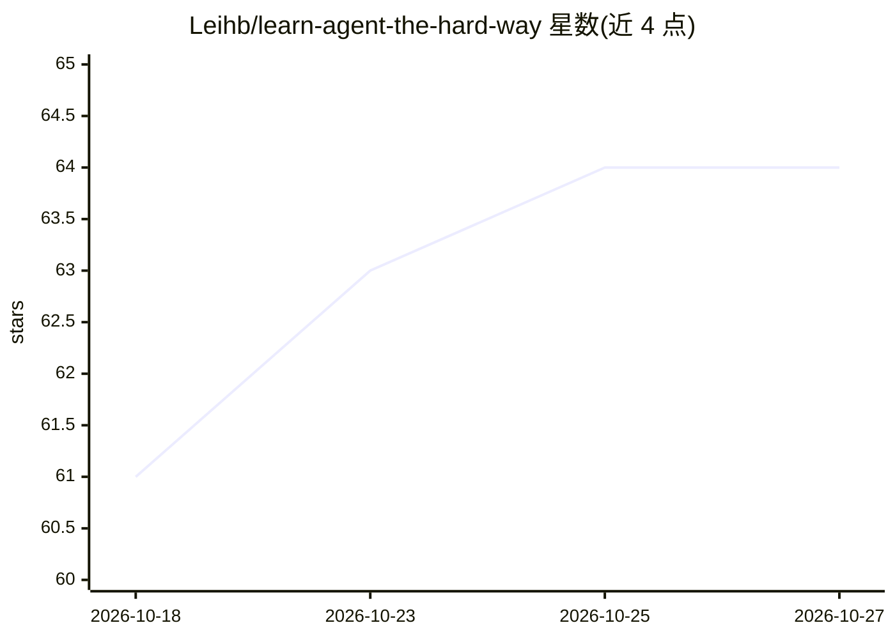

# Leihb/learn-agent-the-hard-way

⭐ 64 · Go · NOASSERTION · 推送 2026-09-20 · [GitHub](https://github.com/Leihb/learn-agent-the-hard-way) · [官网](https://leihb.com/learn-agent-the-hard-way/) · 个人维护 · 中文 README

**中文教程电子书：32 个练习亲手写出一个 agent harness**

面向学习者的开源电子书，主题是不用框架、从裸 HTTP 请求开始用 Go（Python/JavaScript 版本补齐中）亲手实现 agent harness 的各层：工具循环、权限系统、上下文管理、skill、subagent、MCP、浏览器与沙箱，共 32 个练习，每段代码可运行。书中代码从作者开源生产 harness octo 蒸馏而来。需要 Go 1.22+（或 Python 3.10+/Node 18+）与一家模型服务商 key，本机 Ollama 从第一练习起支持。正文采用 CC BY-NC-SA 4.0 许可。

## 筛选速览

| 维度 | 判定 | 备注 |
|---|---|---|
| AI 角色 | `ai-knowledge` | 知识聚合/清单类 |
| 许可风险 | `none` | NOASSERTION |
| 部署形态 | `None` |  |
| 模型依赖 | local-ok | 支持本地模型 |
| 硬件要求 | — | 无带数字的原话,不猜 |
| 安装摩擦 | `low` | 无编译、无系统依赖或容器化 |
| 成熟度 | — | 结构信号不足 |

## 能力要点

- 32 个练习覆盖工具循环、权限、上下文管理、MCP、沙箱等 harness 各层
- 代码以 Go 为母本，Python/JavaScript 版本逐章补齐并经真机验证
- 代码源自真实生产 harness octo 的蒸馏
- 本机 Ollama 从第一个练习起可用，无需付费

## 适用场景

- 理解不依赖框架的 agent 内部机制
- 跟着练习动手实现自己的 agent harness
- 为使用 LangGraph 上线前打基础

## 场景标签

`教程课程` · 领域:学习与行业

## 证据(README 行号)

> L18:  不用任何框架，32 个练习亲手写出一个 agent harness 的每一层，目的是看懂。
> L26: **https://leihb.com/learn-agent-the-hard-way/**

## 星数曲线

2026-10-18 61 → 2026-10-27 64（+3）

---
*卡片 v1 · prompt 1.4 · 生成 2026-10-24 · 置信度 high · 依据 README sha `f27f4feecf2f` · [字段定义](../../DATASET.md)*
