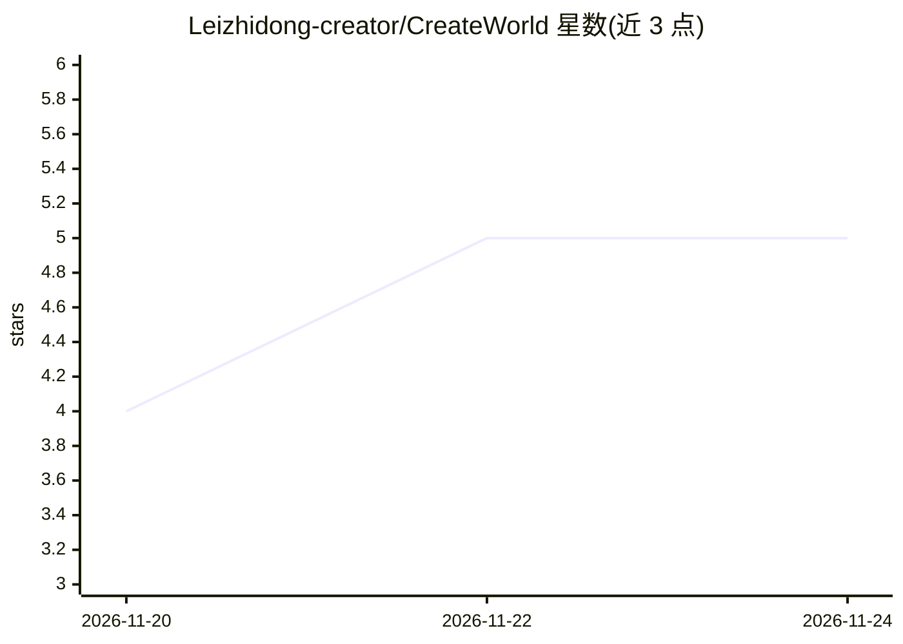

# Leizhidong-creator/CreateWorld

⭐ 5 · Python · NOASSERTION · 推送 2026-11-19 · [GitHub](https://github.com/Leizhidong-creator/CreateWorld) · [官网](https://createworld.games) · 组织维护 · 中文 README

**把一句话/故事制作成可玩 2D 像素剧情游戏的 AI 平台**

Create World 将一句话、小说梗概、剧本或 SRT 字幕输入，交由一个自主安排工作的 AI 团队执行制作：拆分场景、生成像素素材、撰写对白、搭建运行时，并用 Playwright 在真实浏览器中验收，交付可直接运行的 HTML5 游戏。作品发布后支持评论、版本迭代、跨世界角色共创，插件市场提供 Skill、工具、工作流与素材包。完整工作台需本机已登录的 Codex CLI 与 Node.js 24+、Python 3；导出的游戏为纯静态页面，不依赖模型与后端。代码与素材为专有，商用需书面许可。

## 筛选速览

| 维度 | 判定 | 备注 |
|---|---|---|
| AI 角色 | `ai-native` | 本体是模型或模型工具 |
| 许可风险 | `none` | NOASSERTION |
| 部署形态 | `library` | 以包/库形式分发 |
| 模型依赖 | — | README 未给出锁定关系 |
| 硬件要求 | — | 无带数字的原话,不猜 |
| 安装摩擦 | `low` | 无编译、无系统依赖或容器化 |
| 成熟度 | `idea` | |

## 能力要点

- AI 团队自主选择 18 项制作技能与执行顺序，不走固定流水线
- 场景、事件、角色、状态均有稳定 ID 的 YAML 内容规范，可校验可 diff
- Playwright 实测通过的版本才替换当前可玩版本
- 支持静态 HTML5 导出与多世界角色共创

## 适用场景

- 把自己喜欢的故事或 IP 制作成可玩像素游戏
- 为已有角色创作支线或番外
- 将游戏制作经验封装为插件供他人复用
- 将不同作品的角色放入同一世界做联动叙事

## 场景标签

 · 领域:游戏/创作工具

## 证据(README 行号)

> L6: Create World 将一句话、一段小说或一集剧本，制作为可运行的 2D 像素剧情游戏。
> L31: Create World 将这条流程交由一个能自主安排工作的 AI 团队执行：拆分场景、生成像素素材、接入交互，并在真实浏览器中完成验收。交付物是可直接运行的游戏，以及可继续修改的内容档案。
> L142: |智能体|**Codex App Server + 18 Skills**|模型自主选择技能与执行顺序，不使用固定流水线|

## 星数曲线

2026-11-20 4 → 2026-11-24 5（+1）

---
*卡片 v1 · prompt 1.4 · 生成 2026-11-21 · 置信度 high · 依据 README sha `90b9670b01ed` · [字段定义](../../DATASET.md)*
