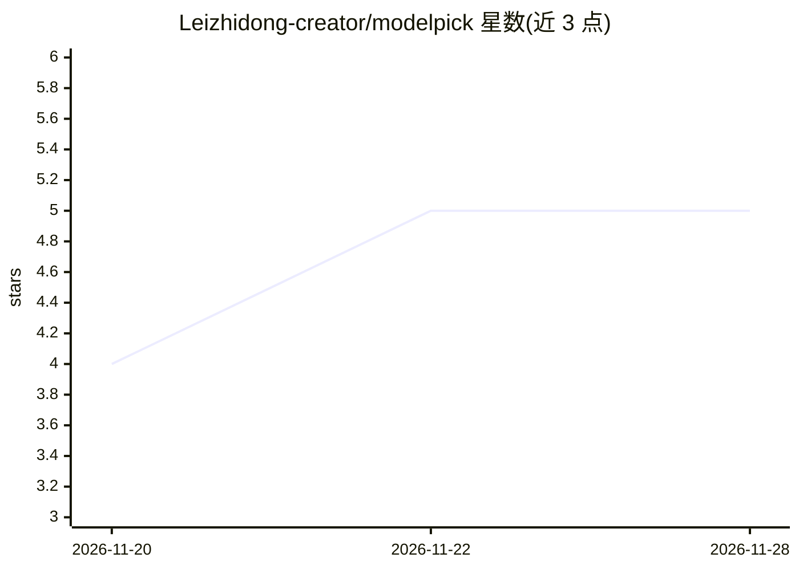

# Leizhidong-creator/modelpick

⭐ 5 · JavaScript · MIT · 推送 2026-11-23 · [GitHub](https://github.com/Leizhidong-creator/modelpick) · [官网](https://leizhidong-creator.github.io/modelpick/) · 个人维护 · 中文 README

**给 AI agent 的模型路由 CLI：按任务节点选模型并计算每任务成本**

零依赖 CLI 与 stdio MCP 服务器，在 agent 工作流的每个节点前回答选哪个模型、实际成本多少、如何接入三件事。覆盖文本/图像/视频/3D/音频 5 种模态、20 个任务节点、40 个模型与 18 家供应商，价格按带日期的快照维护，以 public benchmark 加权的质量分与期望尝试次数计算 cost per solved task。密钥仅存本地，由用户直接调用供应商，不经网关。提供 npm 全局安装或 npx 免安装方式，并通过 setup 命令写入 Claude Code、Codex、Cursor 等客户端配置。

## 筛选速览

| 维度 | 判定 | 备注 |
|---|---|---|
| AI 角色 | `ai-ecosystem` | LLM/agent 周边工具 |
| 许可风险 | `permissive` | MIT |
| 部署形态 | `library` | 以包/库形式分发 |
| 模型依赖 | — | README 未给出锁定关系 |
| 硬件要求 | — | 无带数字的原话,不猜 |
| 安装摩擦 | `low` | 无编译、无系统依赖或容器化 |
| 成熟度 | — | 结构信号不足 |

## 能力要点

- cost per solved task：单价 × 期望尝试次数，而非 $/M tokens
- 支持硬能力过滤（上下文长度、text-in-image、绑定、片段时长、开放权重）
- 以 MCP 服务器与 SKILL.md 接入 Claude Code/Codex/Cursor/DSH/Copilot 等客户端
- 目录为带日期快照，modelpick update 更新、doctor 检查过期

## 适用场景

- 为 agent 的不同节点（编码/生图/3D 资产/视频）挑选不同模型
- 在多个候选模型间按每任务成本做预算权衡
- 为团队使用的 MCP 客户端一键写入 modelpick 配置

## 场景标签

`模型评测` · 领域:评测与运维

## 证据(README 行号)

> L5:  The model router for AI agents — with cost per solved task.
> L22: **ModelPick is a router and cost calculator, not another gateway.** Before each node, it answers three questions in
> L46: **3. Every tool is a new integration.** ModelPick ships as a zero-dependency CLI, a stdio MCP server, a portable `S

## 星数曲线

2026-11-20 4 → 2026-11-28 5（+1）

---
*卡片 v1 · prompt 1.4 · 生成 2026-11-21 · 置信度 high · 依据 README sha `a63f3fa3b9bf` · [字段定义](../../DATASET.md)*
