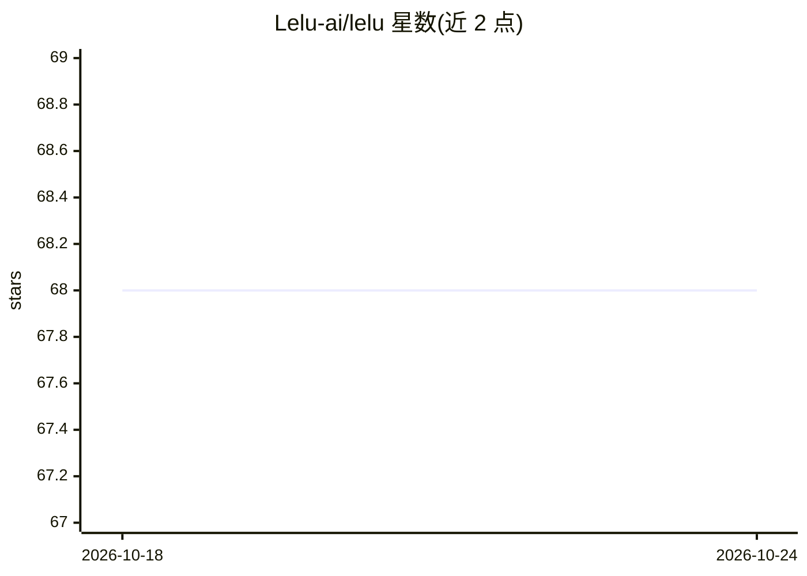

# Lelu-ai/lelu

⭐ 68 · TypeScript · MIT · 推送 2026-10-23 · [GitHub](https://github.com/Lelu-ai/lelu) · [官网](https://lelu-ai.com/) · 组织维护

**AI agent 授权引擎：每次行动前判定允许/拒绝/人工审查**

部署在 AI agent 与外部操作之间的开源授权引擎：agent 执行任何动作前通过一次 HTTP 调用询问 Lelu，返回 allow、deny、human_review 或 compute 四种决策，全部写入审计日志。机制包括 5 层提示注入过滤、基于 LLM 提供方 log-probs 的置信度门控、YAML+OPA/Rego 策略评估、风险模型与人工审查队列（Slack/Teams/PagerDuty）。提供 TypeScript/Python/Go SDK、MCP server 与 Claude Code 插件，MIT 许可，可 npx 一键本地运行或自行构建，stack 为 Go+Next.js+SQLite/Postgres。

## 筛选速览

| 维度 | 判定 | 备注 |
|---|---|---|
| AI 角色 | `ai-ecosystem` | LLM/agent 周边工具 |
| 许可风险 | `permissive` | MIT |
| 部署形态 | `self-host` | docker 或自建部署 |
| 模型依赖 | — | README 未给出锁定关系 |
| 硬件要求 | — | 无带数字的原话,不猜 |
| 安装摩擦 | `low` | 无编译、无系统依赖或容器化 |
| 成熟度 | — | 结构信号不足 |

## 能力要点

- 四类决策（allow/deny/human_review/compute）全量审计日志
- 5 层提示注入过滤与提供方验证的置信度门控
- YAML + OPA/Rego 策略评估，deny-first
- Claude Code 插件经 PreToolUse 钩子拦截 Bash/Edit/Write，默认影子模式

## 适用场景

- 给生产环境 agent 加动作级权限门控
- 提示注入与低置信度行为触发人工审查
- 为 Claude Code / LangChain / CrewAI 等 agent 框架接入合规审计

## 场景标签

`网络安全` · 领域:学习与行业

## 证据(README 行号)

> L29: **Lelu is an open-source authorization engine that sits between your AI agent and the real world.** Before the agen
> L42: Okta tells you **who can do what**. Lelu tells you **when they're doing it wrong**. Traditional auth tools (OPA, Ca
> L143: No — it sits on top. Lelu evaluates OPA/Rego and YAML policies as one step of its pipeline, then adds what those t

## 星数曲线

2026-10-18 68 → 2026-10-24 68（+0）

---
*卡片 v1 · prompt 1.4 · 生成 2026-10-24 · 置信度 high · 依据 README sha `4a0f0aac6a14` · [字段定义](../../DATASET.md)*
