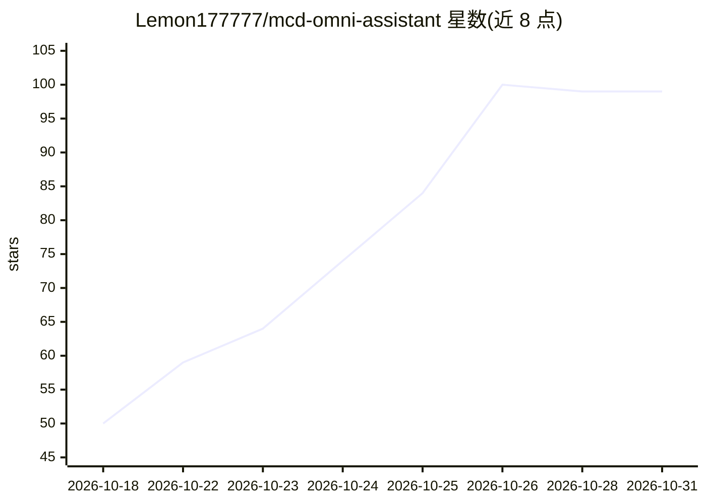

# Lemon177777/mcd-omni-assistant

⭐ 99 · Python · MIT · 推送 2026-10-12 · [GitHub](https://github.com/Lemon177777/mcd-omni-assistant) · 个人维护 · 中文 README

**基于麦当劳中国 MCP 的点餐 Agent Skill 与 CLI 通道**

构建在麦当劳中国官方 MCP Server（mcp-mcp.mcd.cn）之上的全能助手 Skill，覆盖全部 35 个工具，组织为领券、点餐、外送、派对预约、积分止损等 7 大工作流，并以 14 条防错铁律约束参数组合与副作用操作（下单/领券/抽奖需用户确认，不替用户决定积分消耗）。可作为 WorkBuddy Skill 部署给 AI 助手使用，也提供零依赖 CLI（mcd_cli.py）供无 AI 客户端时直接调用。Token 由用户自行从 open.mcd.cn 获取，项目不保存凭证。

## 筛选速览

| 维度 | 判定 | 备注 |
|---|---|---|
| AI 角色 | `ai-ecosystem` | LLM/agent 周边工具 |
| 许可风险 | `permissive` | MIT |
| 部署形态 | `None` |  |
| 模型依赖 | — | README 未给出锁定关系 |
| 硬件要求 | — | 无带数字的原话,不猜 |
| 安装摩擦 | `low` | 无编译、无系统依赖或容器化 |
| 成熟度 | — | 结构信号不足 |

## 能力要点

- 35 个麦当劳 MCP 工具全覆盖，组织为 7 大工作流
- 14 条防错铁律约束参数组合与副作用二次确认
- 积分到期止损脚本默认 dry-run，溢出消耗需用户明确同意
- 零依赖 CLI 通道，无 AI 客户端也可直接调用

## 适用场景

- 让 AI 助手在我的麦当劳账号上完成领券、点餐、外送全流程
- 积分将过期时先 dry-run 查看方案再决定是否消耗
- 不想用 AI 客户端时用命令行直接查询门店、菜单与优惠券

## 场景标签

 · 领域:生活服务/MCP 工具编排

## 证据(README 行号)

> L15: 基于**麦当劳中国官方 MCP Server**（`mcd-mcp` @ `https://mcp.mcd.cn`）构建的全能助手 Skill。
> L69: **方式 A：作为 WorkBuddy Skill（推荐）**
> L177: ├── SKILL.md                     # 主文件：14 条铁律 + 7 大工作流 + 触发对照表

## 星数曲线

2026-10-18 50 → 2026-10-31 99（+49）

---
*卡片 v1 · prompt 1.4 · 生成 2026-10-24 · 置信度 high · 依据 README sha `6011a12f2c3d` · [字段定义](../../DATASET.md)*
