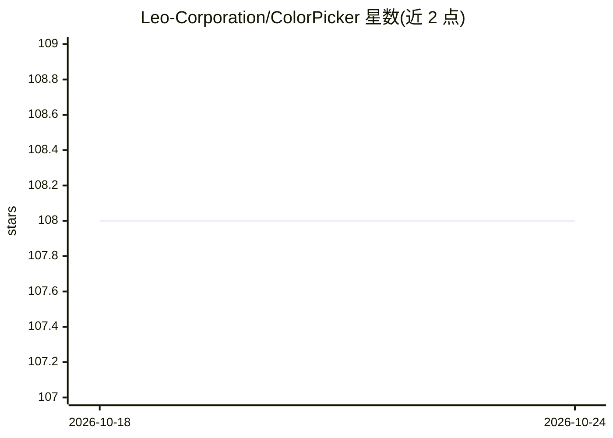

# Leo-Corporation/ColorPicker

⭐ 108 · C# · MIT · 推送 2026-02-20 · [GitHub](https://github.com/Leo-Corporation/ColorPicker) · [官网](https://leocorporation.dev/store/colorpickermax) · 个人维护

**Windows 桌面取色与配色工具，含 AI 自然语言配色建议**

基于 .NET 8 与 WPF 构建的 Windows 颜色工具应用：通过屏幕像素取色、随机生成器或 RGB/HSL 滑块选色，实时转换 RGB、HEX、HSL、CMYK 等 8 种格式；提供色轮、含 WCAG 对比度检测的文字工具、配色方案与线性渐变生成器（可导出 CSS）。AI 功能为按自然语言描述生成颜色建议。提供安装包与便携版两种分发形式，便携版不支持自动更新。

## 筛选速览

| 维度 | 判定 | 备注 |
|---|---|---|
| AI 角色 | `ai-enhanced` | 去掉 AI 部分产品仍成立 |
| 许可风险 | `permissive` | MIT |
| 部署形态 | `None` |  |
| 模型依赖 | — | README 未给出锁定关系 |
| 硬件要求 | — | 无带数字的原话,不猜 |
| 安装摩擦 | `medium` | 含编译或系统依赖之一 |
| 成熟度 | — | 结构信号不足 |

## 能力要点

- 像素取色、随机生成、RGB/HSL 滑块三种选色方式，支持 8 种颜色格式实时转换
- 文字工具给出 WCAG 对比度比率
- 渐变创建器可导出 CSS 代码
- AI 根据自然语言提示生成颜色建议

## 适用场景

- 从屏幕任意像素取色并复制为多种格式
- 为设计稿生成配色方案与 CSS 渐变
- 检查文字前景/背景对比度是否符合 WCAG
- 用一句话描述让 AI 给出配色灵感

## 场景标签

 · 领域:开发者/设计工具

## 证据(README 行号)

> L28: **ColorPicker Max** is a feature-rich and user-friendly color tool built for Windows using **.NET 8** and **WPF**. 
> L98: Leverage AI to generate color suggestions based on natural language prompts. Simply describe the color you envision

## 星数曲线

2026-10-18 108 → 2026-10-24 108（+0）

---
*卡片 v1 · prompt 1.4 · 生成 2026-10-23 · 置信度 high · 依据 README sha `1062c3745c3e` · [字段定义](../../DATASET.md)*
