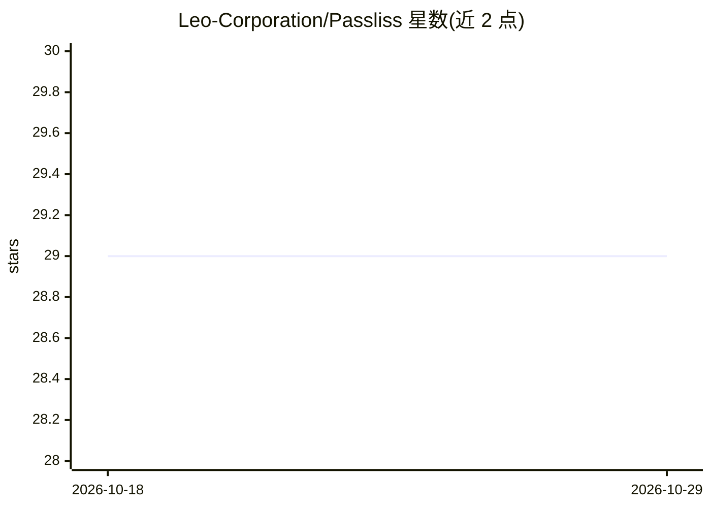

# Leo-Corporation/Passliss

⭐ 29 · TypeScript · MIT · 推送 2026-10-26 · [GitHub](https://github.com/Leo-Corporation/Passliss) · [官网](https://passliss.leocorporation.dev/) · 个人维护

**网页密码生成与分析工具：生成、强度测试与加密**

基于 Next.js/React/TypeScript 的网页应用，提供随机密码生成（长度、字符集、批量生成、CSV 导出、预设配置）、实时强度评分与改进建议，以及 AES/Triple-DES 加密与哈希工具。集成 OpenAI GPT-4o-mini，可通过自然语言提示生成密码。本地运行需 Node.js v20+，经 git clone 与 npm 安装后以 npm run dev 启动。

## 筛选速览

| 维度 | 判定 | 备注 |
|---|---|---|
| AI 角色 | `ai-enhanced` | 去掉 AI 部分产品仍成立 |
| 许可风险 | `permissive` | MIT |
| 部署形态 | `library` | 以包/库形式分发 |
| 模型依赖 | — | README 未给出锁定关系 |
| 硬件要求 | — | 无带数字的原话,不猜 |
| 安装摩擦 | `low` | 无编译、无系统依赖或容器化 |
| 成熟度 | — | 结构信号不足 |

## 能力要点

- 可配置字符集与长度的密码生成，支持批量与 CSV 导出
- OpenAI GPT-4o-mini 自然语言生成密码
- 实时强度评分与改进建议
- AES / Triple-DES 加解密与哈希工具

## 适用场景

- 生成符合特定要求的随机密码
- 检查现有密码的强度并获取改进建议
- 对字符串做加密或哈希处理

## 场景标签

`网络安全` · 领域:学习与行业

## 证据(README 行号)

> L27: Passliss is a modern and secure web application for generating, analyzing, and managing passwords. It provides a cl
> L50: Passliss also integrates OpenAI’s GPT-4o-mini to let you generate secure passwords from natural language prompts. W

## 星数曲线

2026-10-18 29 → 2026-10-29 29（+0）

---
*卡片 v1 · prompt 1.4 · 生成 2026-10-26 · 置信度 high · 依据 README sha `1acee579c923` · [字段定义](../../DATASET.md)*
