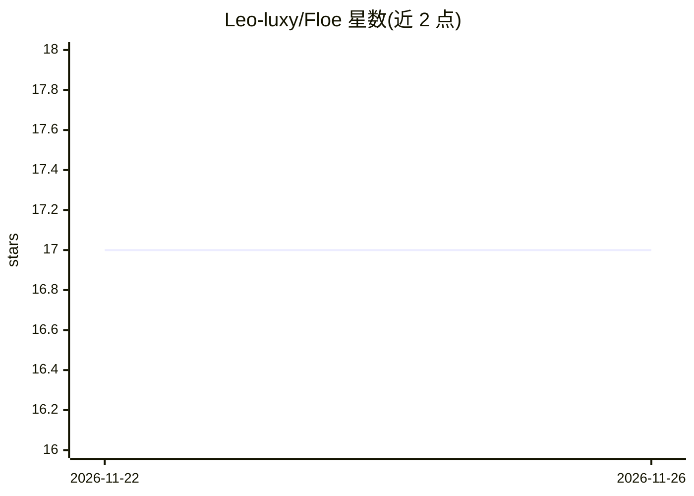

# Leo-luxy/Floe

⭐ 17 · Python · MIT · 推送 2026-11-24 · [GitHub](https://github.com/Leo-luxy/Floe) · 个人维护 · 中文 README

**A股投资者本地量化选股与五维 AI 决策桌面工作台**

运行于本机的 A 股趋势选股与投资决策桌面软件（前身 GP_ANA）：聚合 Tushare、akshare、东方财富、新浪多源行情与财报、资金流、股东、研报数据，按技术、财务、情绪估值、股东结构、研报五维加权评估，先做两层 LLM 冲突检测再生成含风控价格的情景交易计划，并结合 FIFO 台账的真实持仓成本。选股→关注池→回测监控三步闭环，支持回测身份校验、选股快照归档与本机历次选股收益追踪。提供桌面安装包、Homebrew、npm 与源码四种部署方式；源码部署须先装 TA-Lib C 库，选股功能需 Tushare 120 积分以上 Token。声明仅供个人研究学习，不构成投资建议。

## 筛选速览

| 维度 | 判定 | 备注 |
|---|---|---|
| AI 角色 | `ai-native` | 本体是模型或模型工具 |
| 许可风险 | `permissive` | MIT |
| 部署形态 | `desktop` | 安装包/桌面程序 |
| 模型依赖 | local-ok | 支持本地模型 |
| 硬件要求 | — | 无带数字的原话,不猜 |
| 安装摩擦 | `medium` | 含编译或系统依赖之一 |
| 成熟度 | — | 结构信号不足 |

## 能力要点

- 五维加权研判 + 两层 LLM 冲突推理（风险经理→交易教练）
- 云端 OpenAI 兼容 API（预设 DeepSeek/硅基流动等）与本地 Ollama 双模切换
- 三位小数（0.001 元）FIFO 实盘买卖台账，持仓成本注入第二层 AI 决策
- 跨平台桌面安装包（dmg/zip/AppImage）与 Homebrew、npm 分发

## 适用场景

- 每日复盘时全市场扫描当日新触发趋势标的
- 重仓建仓前做五维基本面排雷并生成含风控价格的交易计划
- 用 FIFO 台账核算实盘每手盈亏并联动 AI 决策
- 隐私敏感场景下切换本地 Ollama 让数据不出本机

## 场景标签

`金融量化` · 领域:学习与行业

## 证据(README 行号)

> L19: **Floe**（前身 **GP_ANA**）是一套运行在你自己电脑上的 **A 股趋势选股与多维 AI 投资决策软件**。
> L21: 它把散落在各处的股票信息——全市场日线筛选、前复权行情、财报质量、主力资金流、融资融券、股东筹码、机构研报——自动拉取并做严格时效与指纹校验，再通过 **云端大模型 API（默认推荐 DeepSeek，兼容任意 OpenAI 接口
> L70: ### 3️⃣ 云端 DeepSeek / OpenAI API + 本地 Ollama 双模驱动

## 星数曲线

2026-11-22 17 → 2026-11-26 17（+0）

---
*卡片 v1 · prompt 1.4 · 生成 2026-11-22 · 置信度 mid · 依据 README sha `51a38c706f17` · [字段定义](../../DATASET.md)*
