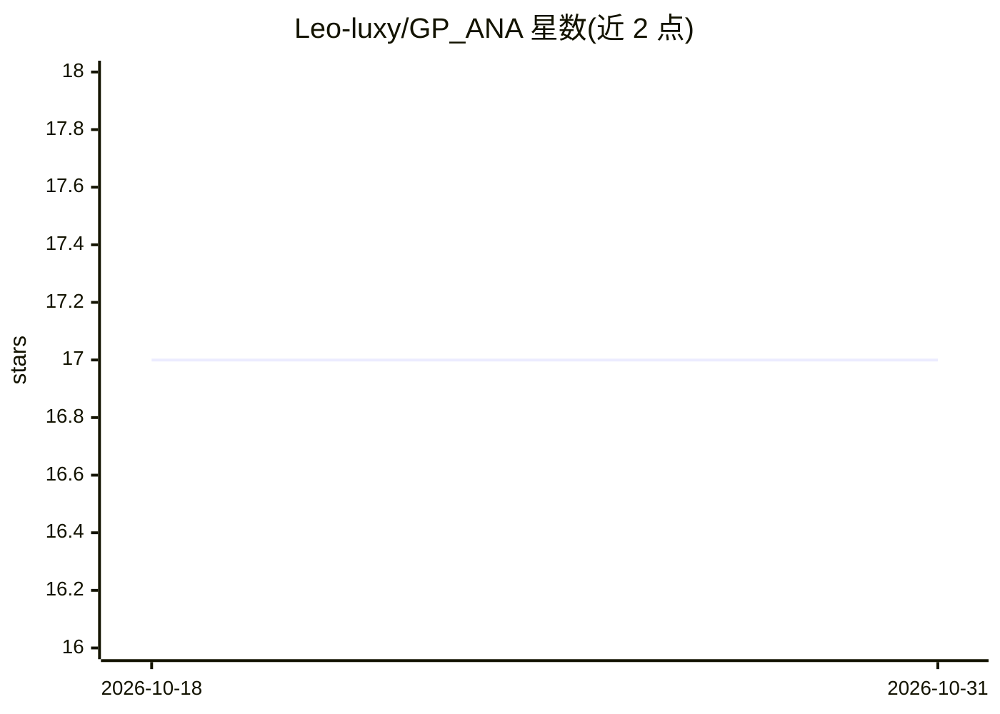

# Leo-luxy/GP_ANA

⭐ 17 · Python · MIT · 推送 2026-09-30 · [GitHub](https://github.com/Leo-luxy/GP_ANA) · 个人维护 · 中文 README

**本地运行的个人投资者 A 股 AI 分析决策系统**

部署在个人电脑上的 A 股投资分析系统：从 akshare、东方财富、新浪财经、Tushare 等公开接口自动采集行情、财报、资金流、融资融券、股东与研报数据，经本地 Ollama 大模型做五维度研判（技术/财务/情绪/股东/研报）与两层决策，输出带持仓成本的交易计划；另含策略回测、全市场选股流水线与 Flask Web 界面（端口 8081 硬编码）。需手动配置 config.py、TA-Lib 系统库与 Ollama 模型；市场选股功能需申请 Tushare token（120 积分以上）。

## 筛选速览

| 维度 | 判定 | 备注 |
|---|---|---|
| AI 角色 | `ai-native` | 本体是模型或模型工具 |
| 许可风险 | `permissive` | MIT |
| 部署形态 | `library` | 以包/库形式分发 |
| 模型依赖 | local-ok | 支持本地模型 |
| 硬件要求 | — | 无带数字的原话,不猜 |
| 安装摩擦 | `medium` | 含编译或系统依赖之一 |
| 成熟度 | — | 结构信号不足 |

## 能力要点

- 五维度研判 + 两层 AI 决策（冲突检测→持仓交易计划）
- AI 推理全本地 Ollama，无需云端 API key，数据不出本机
- 20+ 采集器多源冗余与自动容错，增量更新
- 全市场选股流水线：5500+ 只→筛选→逐只回测→持仓清单

## 适用场景

- 个人投资者对本机股票池做完整 AI 研判与复盘
- 结合真实持仓成本获得针对性 AI 交易建议
- 全市场筛选与趋势策略回测验证

## 场景标签

`金融量化` · 领域:学习与行业

## 证据(README 行号)

> L14: GP_ANA 是一套跑在你自己电脑上的 **A 股投资决策系统**。
> L67: - AI 推理跑在 **本机 Ollama**，**不需要任何云端 API key**（可以自行配置云端API）

## 星数曲线

2026-10-18 17 → 2026-10-31 17（+0）

---
*卡片 v1 · prompt 1.4 · 生成 2026-10-30 · 置信度 high · 依据 README sha `8d9d9031ff5d` · [字段定义](../../DATASET.md)*
