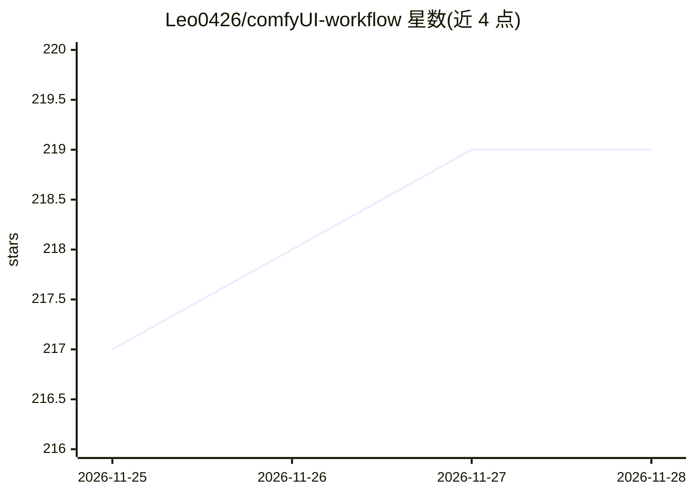

# Leo0426/comfyUI-workflow

⭐ 219 · Python · MIT · 推送 2026-06-22 · [GitHub](https://github.com/Leo0426/comfyUI-workflow) · 个人维护 · 中文 README

**为 ComfyUI 用户提供 584 个多场景生图工作流的合集**

仓库收录 584 个 ComfyUI 工作流 JSON 文件，按 11 个类别组织（动画视频、换脸人像、电商换装、抠图、画质修复、2D→3D、室内设计、摄影写真、文字艺术、创意趣玩、入门基础），并提供自动生成的 INDEX.md 与机器可读 index.json。每个工作流附作用描述与所需模型清单；列出 9 个被 50 个以上工作流使用的常用自定义节点包，配套模型下载表指向 Hugging Face、Meta、Civitai。使用前提是 ComfyUI 已安装，工作流模型需单独下载。templates/ 中少量文件名标注禁止商用的工作流不受仓库 MIT 许可证覆盖。

## 筛选速览

| 维度 | 判定 | 备注 |
|---|---|---|
| AI 角色 | `ai-knowledge` | 知识聚合/清单类 |
| 许可风险 | `permissive` | MIT |
| 部署形态 | `None` |  |
| 模型依赖 | — | README 未给出锁定关系 |
| 硬件要求 | — | 无带数字的原话,不猜 |
| 安装摩擦 | `low` | 无编译、无系统依赖或容器化 |
| 成熟度 | — | 结构信号不足 |

## 能力要点

- 584 个工作流 JSON，覆盖 11 个类别，附自动生成的 INDEX.md 与机器可读 index.json
- 列出 9 个高频自定义节点包，可通过 ComfyUI-Manager 一键安装缺失节点
- 提供模型下载表（SDXL、AnimateDiff、InstantID、SAM 等）及对应目录放置说明
- 提供 gen_index.py / gen_templates_index.py 脚本重新生成索引

## 适用场景

- 在 ComfyUI 中直接加载现成工作流完成生图、换脸、动画等任务
- 为电商换装、室内渲染等业务场景查找对应工作流模板
- 作为 ComfyUI 入门学习的示例集合

## 场景标签

`图像生成` `视频生成` · 领域:内容生成

## 证据(README 行号)

> L3: > **584** 个精选 ComfyUI 工作流，覆盖 AI 生图、换脸、动画、修复、电商、室内设计等主流场景。
> L13: ├── templates/          # 所有工作流 JSON（584 个，扁平结构）

## 星数曲线

2026-11-25 217 → 2026-11-28 219（+2）

---
*卡片 v1 · prompt 1.4 · 生成 2026-11-24 · 置信度 high · 依据 README sha `f378f15d6856` · [字段定义](../../DATASET.md)*
