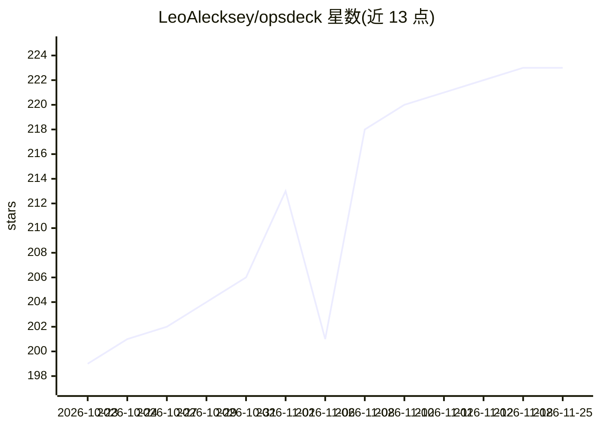

# LeoAlecksey/opsdeck

⭐ 223 · TypeScript · MIT · 推送 2026-11-22 · [GitHub](https://github.com/LeoAlecksey/opsdeck) · [官网](https://leoalecksey.github.io/opsdeck/) · 个人维护

**单窗口 DevOps 工作台：终端+本地 AI+K8s+SSH+数据库+IDE**

基于 Rust + Tauri 2 的桌面应用，把 DevOps 工程师的日常工具集成到一个窗口：Warp 风格终端、Kubernetes 管理、SSH 主机、数据库客户端、带 git 的编辑器、Grafana/ArgoCD/GitLab 标签页、告警、笔记任务、KeePass/Passbolt 密码访问。AI 部分：内置 llama.cpp 本地模型（默认 Qwen2.5-Coder 1.5B，离线可用）、右侧 AI 面板运行 Claude Code/Codex 等 CLI 工具，以及带主机访问级别与命令黑名单的受限 AI agent。提供 Linux/Windows/macOS 安装包。

## 筛选速览

| 维度 | 判定 | 备注 |
|---|---|---|
| AI 角色 | `ai-enhanced` | 去掉 AI 部分产品仍成立 |
| 许可风险 | `permissive` | MIT |
| 部署形态 | `desktop` | 安装包/桌面程序 |
| 模型依赖 | local-ok | 支持本地模型 |
| 硬件要求 | — | 无带数字的原话,不猜 |
| 安装摩擦 | `low` | 无编译、无系统依赖或容器化 |
| 成熟度 | — | 结构信号不足 |

## 能力要点

- 内置 llama.cpp 本地 AI，离线运行，Settings 内选择模型并按内存/GPU 提示可运行性
- AI agent 逐主机访问级别控制（只读/变更需确认）并禁止解释器与不可逆命令
- Kubernetes 管理：问题检测表、聚合 pod 日志、生产上下文只读模式
- SSH 主机监控、双窗格文件传输、Yandex Cloud 与 MikroTik 集成

## 适用场景

- 在一个窗口完成终端、SSH、K8s、数据库的日常运维操作
- 离线环境下用本地模型把自然语言转成命令
- 让 AI agent 在受限权限下排查服务器问题
- 生产环境用只读模式查看集群与数据库

## 场景标签

`AI 助手` · 领域:对话与助手

## 证据(README 行号)

> L10: **A DevOps engineer's workspace in one window**: a terminal with an AI panel and a local model, an AI agent that in
> L34: - Runs on llama.cpp, installed from Settings if you want it, works offline: the light Qwen2.5-Coder 1.5B (≈1.1 GB) 
> L41: - **Access level per host**: stay away / read only / change with permission / change freely. On a read-only host a 

## 星数曲线

2026-10-23 199 → 2026-11-25 223（+24）

---
*卡片 v1 · prompt 1.4 · 生成 2026-11-25 · 置信度 mid · 依据 README sha `9e0215fbd14a` · [字段定义](../../DATASET.md)*
