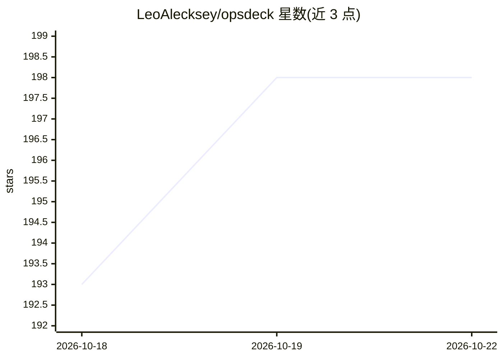

# LeoAlecksey/opsdeck

⭐ 199 · TypeScript · MIT · 推送 2026-10-22 · [GitHub](https://github.com/LeoAlecksey/opsdeck) · [官网](https://leoalecksey.github.io/opsdeck/) · 个人维护

**DevOps 工程师一体化桌面驾驶舱：终端+AI+K8s+数据库+IDE**

用 Rust + Tauri 2 构建的原生跨平台桌面应用（Linux/Windows/macOS），把 DevOps 日常工作聚合到一个窗口：Warp 风格终端（含命令块、错误时一键问 AI）、类 Lens 的 Kubernetes 视图（watch、日志、Helm/ArgoCD、只读模式）、PostgreSQL/MySQL/ClickHouse 等数据库客户端、带 git 的轻量 IDE、Grafana/ArgoCD/GitLab 内嵌标签页与告警收件箱、KeePass/Passbolt/SSH/MikroTik、Markdown 笔记与任务。AI 能力包括侧栏接入 Claude Code 等 CLI、可选 llama.cpp 本地模型（默认 Qwen2.5-Coder 1.5B，约 1.1GB 磁盘、1.5GB 内存）与内置知识库；本地 AI 为可选组件，不装不影响其他功能。

## 筛选速览

| 维度 | 判定 | 备注 |
|---|---|---|
| AI 角色 | `ai-enhanced` | 去掉 AI 部分产品仍成立 |
| 许可风险 | `permissive` | MIT |
| 部署形态 | `desktop` | 安装包/桌面程序 |
| 模型依赖 | local-ok | 支持本地模型 |
| 硬件要求 | — | 无带数字的原话,不猜 |
| 安装摩擦 | `low` | 无编译、无系统依赖或容器化 |
| 成熟度 | — | 结构信号不足 |

## 能力要点

- 命令块终端：每条命令带退出码，出错可一键发送 AI 分析
- Kubernetes watch 表格、日志、Helm/ArgoCD 管理，生产上下文可后端强制只读
- AI 侧栏运行 Claude Code/Codex/Gemini/Aider/OpenCode，Claude Code 可经 MCP WebSocket 作为 IDE 接入
- 可选 llama.cpp 本地模型离线生成命令，内置 23 主题 250+ 命令知识库注入提示

## 适用场景

- 在一个窗口里完成终端、K8s 运维、数据库查询和 git 操作
- 命令出错时直接让 AI 侧栏解释并给出修复命令
- 离线环境下用本地小模型把自然语言转成终端命令
- 统一接收 Grafana/Alertmanager 告警并做 AI 分析

## 场景标签

`AI 助手` · 领域:对话与助手

## 证据(README 行号)

> L7: **Единая рабочая панель DevOps-инженера**: терминал с AI рядом и локальной моделью, Kubernetes, базы данных, встроен
> L11: > *English:* runs on Linux (glibc 2.35+, e.g. Ubuntu 22.04+, Debian 12+, Fedora 36+), Windows 10/11 and macOS 10.13
> L26: - **Локальный ИИ** `Ctrl+Shift+K`: опишите словами, что сделать, — получите команду с учётом ваших заметок и истори

## 星数曲线

2026-10-18 193 → 2026-10-22 198（+5）

---
*卡片 v1 · prompt 1.4 · 生成 2026-10-22 · 置信度 mid · 依据 README sha `e4c94f945067` · [字段定义](../../DATASET.md)*
