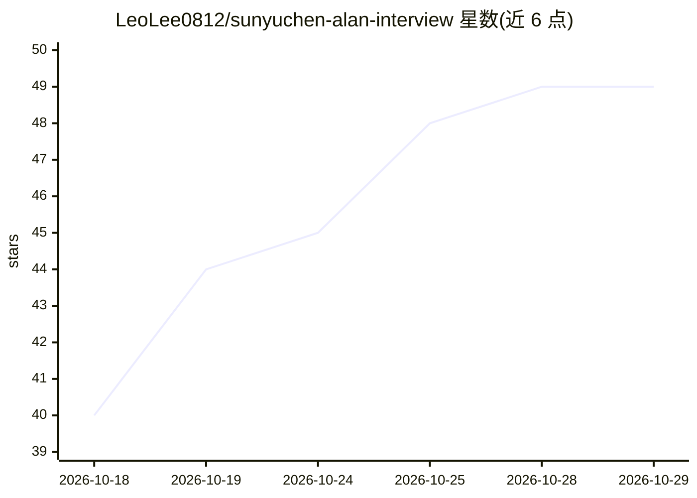

# LeoLee0812/sunyuchen-alan-interview

⭐ 49 · 推送 2026-10-09 · [GitHub](https://github.com/LeoLee0812/sunyuchen-alan-interview) · 个人维护 · 中文 README

**孙宇晨访谈 4 小时 22 分中文逐字稿，约 7.5 万字带时间戳**

整理邵艾伦 Alan 访谈孙宇晨的全文逐字稿：约 7.5 万字、682 个话轮，每句附原片时间戳，按话题切为 16 章，以 Markdown 文件提供，支持仓库内全文搜索与整体喂给 AI 做总结。制作方式为语音自动转写后对照原音人工校订，只修错误（人名、术语、数字等），保留口癖与语气词，不确定处标注「存疑」共 80 多处。版权声明指明内容归原对话者与发布方，仓库仅作文字整理。

## 筛选速览

| 维度 | 判定 | 备注 |
|---|---|---|
| AI 角色 | `ai-knowledge` | 知识聚合/清单类 |
| 许可风险 | `none` | — |
| 部署形态 | `None` |  |
| 模型依赖 | — | README 未给出锁定关系 |
| 硬件要求 | — | 无带数字的原话,不猜 |
| 安装摩擦 | `low` | 无编译、无系统依赖或容器化 |
| 成熟度 | — | 结构信号不足 |

## 能力要点

- 682 个话轮逐句附原片时间戳，可回原片核对
- 按话题切成 16 章并附章节目录
- 转写后人工校订，不润色不删句，80 余处标注存疑
- Markdown 格式，支持搜索及整体输入 AI

## 适用场景

- 按时间戳检索访谈中的原话
- 把完整逐字稿交给 AI 做总结或分析
- 按章节只阅读感兴趣的话题段落

## 场景标签

 · 领域:访谈/播转录文本

## 证据(README 行号)

> L10: 4 个多小时的视频没几个人能一口气看完。这里是它的全文逐字稿，约 7.5 万字、682 个话轮，每句话都带原片时间戳，另外按话题切成了 16 章。
> L12: 想找某句话，在仓库里直接搜；想喂给 AI 做总结，把 `完整逐字稿.md` 整个丢进去。

## 星数曲线

2026-10-18 40 → 2026-10-29 49（+9）

---
*卡片 v1 · prompt 1.4 · 生成 2026-10-25 · 置信度 high · 依据 README sha `c0e2cdc8f250` · [字段定义](../../DATASET.md)*
